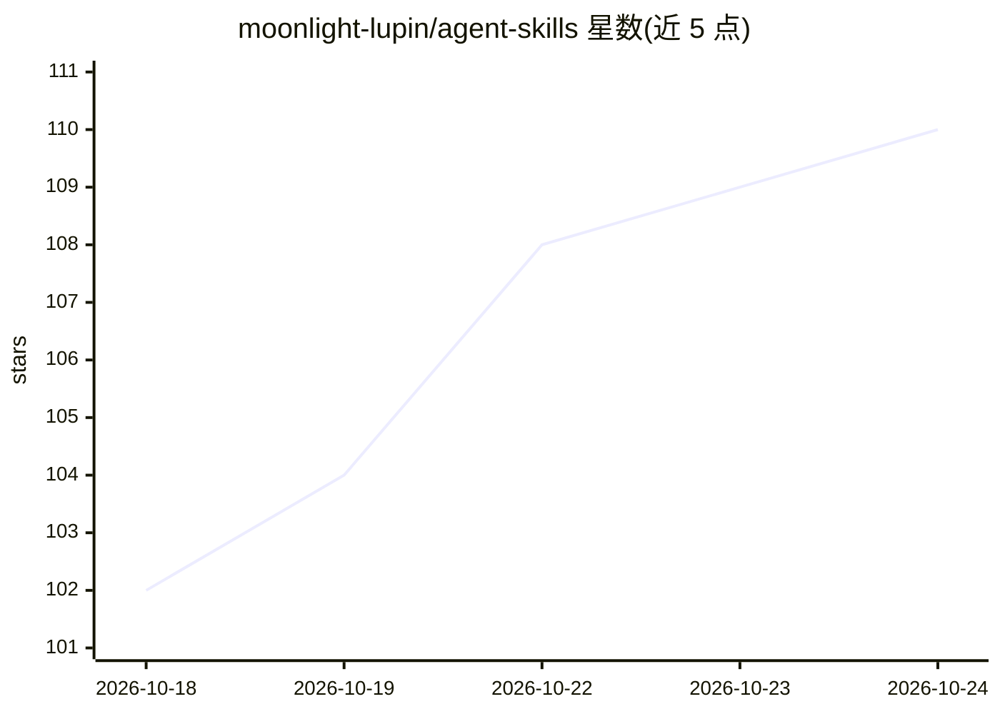

# moonlight-lupin/agent-skills

⭐ 111 · Python · MIT · 推送 2026-10-22 · [GitHub](https://github.com/moonlight-lupin/agent-skills) · [官网](https://hermes-agent.nousresearch.com) · 个人维护

**面向 Hermes Agent 的技能与插件集合，按领域组织**

为 Hermes Agent 构建的自包含技能库：约 35 个技能按 research/creative/productivity/agent-ops/devops 等领域组织，每个技能独立文件夹可选装，多为纯提示词或 Python 标准库实现并附测试；成熟度表标注 Stable/Beta 与依赖（如 fal.ai、Pexels、PDL 等需 API key）。工作流与脚本设计为 agent 无关，Claude Code、Codex、OpenCode、LangGraph 等平台可通过映射工具名适配。另含两个 Hermes 插件：skill-retrieval（BM25 技能检索）与 lumen（对话历史转 markdown wiki）。

## 筛选速览

| 维度 | 判定 | 备注 |
|---|---|---|
| AI 角色 | `ai-knowledge` | 知识聚合/清单类 |
| 许可风险 | `permissive` | MIT |
| 部署形态 | `library` | 以包/库形式分发 |
| 模型依赖 | — | README 未给出锁定关系 |
| 硬件要求 | — | 无带数字的原话,不猜 |
| 安装摩擦 | `low` | 无编译、无系统依赖或容器化 |
| 成熟度 | — | 结构信号不足 |

## 能力要点

- 约 35 个技能按领域组织，每个独立文件夹、多数附测试
- 技能为 agent 无关设计，可映射到 Claude Code/Codex/OpenCode/LangGraph 等平台
- skill-retrieval 插件用 BM25 检索替代完整技能清单注入，仅用标准库
- lumen 插件将对话历史与记忆维护为带来源标注的 markdown wiki

## 适用场景

- 为 Hermes Agent 或其他 agent 框架挑选即用的研究/生产力/开发技能
- 技能库规模扩大后用 skill-retrieval 插件降低每轮输入 token 开销
- 将 agent 对话历史整理为可维护的知识 wiki
- 参考 SKILL.md 格式的技能编写与维护方法

## 场景标签

`提示工程` `Agent 记忆` · 领域:Agent 开发

## 证据(README 行号)

> L7: A collection of AI agent skills built for Hermes Agent, organised by domain. Each skill is self-contained in its own
> L9: > **Portability:** These skills are written for Hermes's tool architecture (`web_search`, `web_extract`, `terminal`,

## 星数曲线

2026-10-18 102 → 2026-10-24 110（+8）

---
*卡片 v1 · prompt 1.4 · 生成 2026-10-23 · 置信度 mid · 依据 README sha `8858318aadd7` · [字段定义](../../DATASET.md)*
