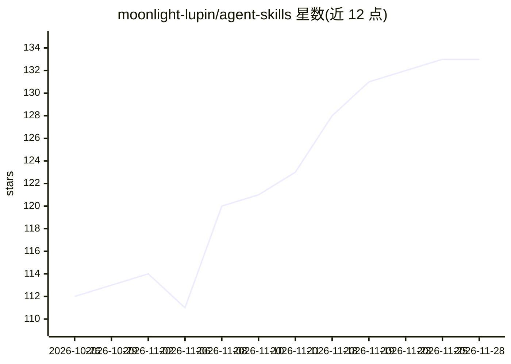

# moonlight-lupin/agent-skills

⭐ 133 · Python · MIT · 推送 2026-11-27 · [GitHub](https://github.com/moonlight-lupin/agent-skills) · [官网](https://hermes-agent.nousresearch.com) · 个人维护

**为 Hermes Agent 提供按领域组织的 AI agent 技能与插件集**

面向 Hermes Agent 的技能与插件仓库，按 creative、research、mlops、productivity、agent-ops、devops 等领域目录组织，每个技能独立成文件夹、自选安装。技能以 SKILL.md 格式编写，覆盖深度研究、语义检索、多模型对比评测、文件整理、票据报销 PDF 生成等；插件部分提供基于 BM25 的技能检索（top-K 注入控制 token 开销）、会话历史转 markdown wiki 的维护工具，以及带创建门控的开发流水线。技能的工作流与脚本可被其他平台 agent 改编使用。

## 筛选速览

| 维度 | 判定 | 备注 |
|---|---|---|
| AI 角色 | `ai-ecosystem` | LLM/agent 周边工具 |
| 许可风险 | `permissive` | MIT |
| 部署形态 | `library` | 以包/库形式分发 |
| 模型依赖 | — | README 未给出锁定关系 |
| 硬件要求 | — | 无带数字的原话,不猜 |
| 安装摩擦 | `low` | 无编译、无系统依赖或容器化 |
| 成熟度 | — | 结构信号不足 |

## 能力要点

- 33 个自包含技能按领域目录组织，逐个文件夹安装
- skill-retrieval 插件用 BM25 从技能目录中检索 top-K 注入提示词
- deep-research 技能含四标签证据纪律与确定性校验门
- lumen 插件把会话历史维护为带来源归属的 markdown wiki

## 适用场景

- 给 Hermes Agent 添加研究、评测、自动化等现成技能
- 技能目录过大时用检索插件控制每轮 token 开销
- 把 agent 会话历史整理成可持续维护的 wiki

## 场景标签

`工作流自动化` `模型评测` · 领域:效率与自动化

## 证据(README 行号)

> L7: A collection of AI agent skills built for Hermes Agent, organised by domain. Each skill is self-contained in its own
> L67: A Hermes plugin that scales skill usage to large libraries. As a skill catalog grows past a few dozen entries, the 

## 星数曲线

2026-10-26 112 → 2026-11-28 133（+21）

---
*卡片 v1 · prompt 1.4 · 生成 2026-11-28 · 置信度 mid · 依据 README sha `8a419944edfc` · [字段定义](../../DATASET.md)*
