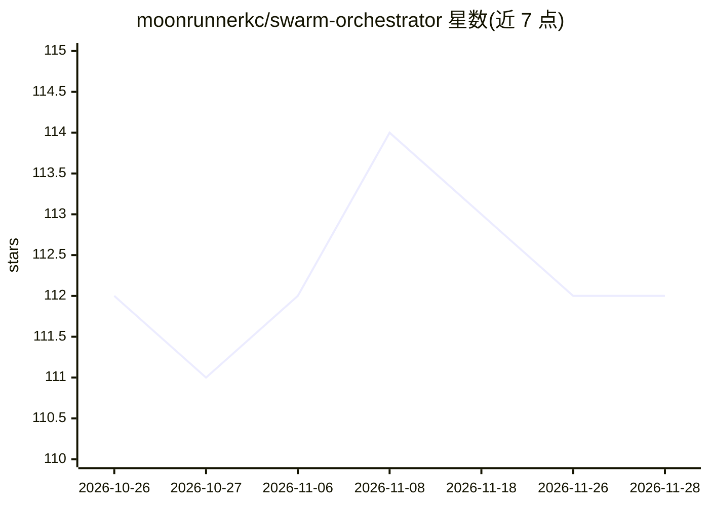

# moonrunnerkc/swarm-orchestrator

⭐ 112 · TypeScript · ISC · 推送 2026-11-27 · [GitHub](https://github.com/moonrunnerkc/swarm-orchestrator) · [官网](https://github.com/moonrunnerkc/swarm-orchestrator#readme) · 个人维护

**本地模型驱动的编码 agent：改代码并附签名验证证据**

运行于本地模型的编码 agent：接收 git 仓库中的工程任务，在树的副本上修改代码，用模型未编写的测试逐条核验需求，失败则修复，最终返回补丁与完成情况报告。依赖 Node 22.13+、Ollama 或 OpenAI 兼容端点、Docker 守护进程（容器无网络隔离运行，`--host` 可本机运行）。草拟的检查需用户批准，验证记录带签名以实现防篡改。面向希望在本地用 AI 完成编码任务的开发者。

## 筛选速览

| 维度 | 判定 | 备注 |
|---|---|---|
| AI 角色 | `ai-native` | 本体是模型或模型工具 |
| 许可风险 | `permissive` | ISC |
| 部署形态 | `library` | 以包/库形式分发 |
| 模型依赖 | local-ok | 支持本地模型 |
| 硬件要求 | — | 无带数字的原话,不猜 |
| 安装摩擦 | `low` | 无编译、无系统依赖或容器化 |
| 成熟度 | — | 结构信号不足 |

## 能力要点

- 在代码副本上修改并返回补丁与逐条需求状态报告
- 每次验证生成签名记录，补丁或报告被改动后不再匹配
- 草拟检查在终端中供批准/编辑/拒绝，未经审阅的草稿会在报告中标注
- 支持从代码示例学习约定规则并作为后续运行的要求

## 适用场景

- 让本地模型按任务描述自动修改代码并拿到可核验的补丁
- 为每个任务需求补充独立于模型的测试检查
- 在容器隔离环境下运行 AI 编码任务，避免接触凭证与网络

## 场景标签

`编码 Agent` · 领域:编码与开发

## 证据(README 行号)

> L6: Swarm is a coding agent that runs on a local model. Give it an engineering task in a git
> L15: - Ollama with at least one model installed, or any OpenAI-compatible
> L24: npm install -g swarm-orchestrator

## 星数曲线

2026-10-26 112 → 2026-11-28 112（+0）

---
*卡片 v1 · prompt 1.4 · 生成 2026-11-28 · 置信度 high · 依据 README sha `2fa93e4c61de` · [字段定义](../../DATASET.md)*
