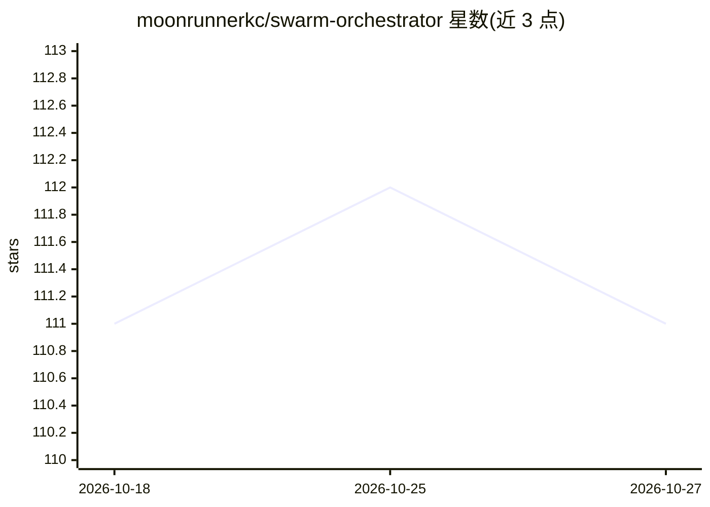

# moonrunnerkc/swarm-orchestrator

⭐ 111 · TypeScript · ISC · 推送 2026-10-25 · [GitHub](https://github.com/moonrunnerkc/swarm-orchestrator) · [官网](https://github.com/moonrunnerkc/swarm-orchestrator#readme) · 个人维护

**命令行编码 agent：以项目检查为准绳完成 git 仓库修改并留可验证证据**

面向 git 仓库的终端编码代理：用自然语言描述改动，本地或托管模型编辑工作区，运行项目自身检查作为封闭门禁，在固定次数内修复失败，并输出每条命令的签名、哈希链证据记录，可离线核验。要求不被检查覆盖的需求报告为未确立而非通过；修复不得删除测试换取绿灯；未加 --isolation 时命令按路径策略在用户机器上运行而非沙箱。需要 Node 22+ 与可用单命令运行测试的仓库。README 自述处于实验阶段。

## 筛选速览

| 维度 | 判定 | 备注 |
|---|---|---|
| AI 角色 | `ai-native` | 本体是模型或模型工具 |
| 许可风险 | `permissive` | ISC |
| 部署形态 | `library` | 以包/库形式分发 |
| 模型依赖 | local-ok | 支持本地模型 |
| 硬件要求 | — | 无带数字的原话,不猜 |
| 安装摩擦 | `low` | 无编译、无系统依赖或容器化 |
| 成熟度 | `idea` | |

## 能力要点

- 以项目真实检查作为封闭门禁判定完成状态
- 签名、哈希链证据记录可用 verify.mjs 离线核验
- 修复过程禁止删除测试使检查变绿
- 六种结局状态与对应退出码（accepted/unverified 等）

## 适用场景

- 让 agent 在 git 仓库中实现功能并自动跑测试修复
- 要求改动有可离线核验的执行证据记录
- 以检查而非模型自述来判定任务是否完成

## 场景标签

`编码 Agent` · 领域:编码与开发

## 证据(README 行号)

> L3: `swarm` is a command-line coding agent for git repositories. You describe a change in plain
> L4: words; it edits your working tree with a local or hosted model, runs your project's checks,

## 星数曲线

2026-10-18 111 → 2026-10-27 111（+0）

---
*卡片 v1 · prompt 1.4 · 生成 2026-10-23 · 置信度 high · 依据 README sha `02ea3cf2a274` · [字段定义](../../DATASET.md)*
