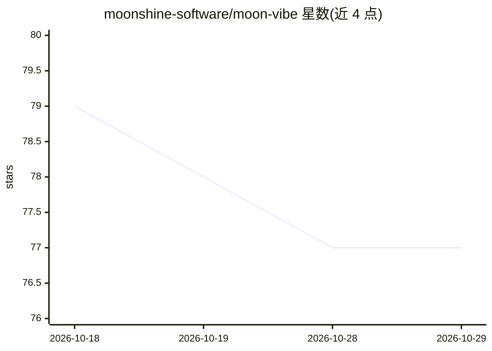

# moonshine-software/moon-vibe

⭐ 77 · PHP · 推送 2025-11-26 · [GitHub](https://github.com/moonshine-software/moon-vibe) · [官网](https://getmoonshine.app) · 组织维护

**用自然语言生成 Laravel+MoonShine 管理面板的 Web 应用**

基于 Laravel 12 与 MoonShine 3 的自托管 Web 应用：用户以自然语言描述需求，连接 OpenAI/DeepSeek/OpenRouter 的 API 模型，自动生成含数据库表结构、Eloquent 模型、迁移与 MoonShine 资源的完整 Laravel 项目，可实时查看进度、预览、下载 tar 包或在站内直接测试。带 AI 校验与迭代纠错、用户角色与订阅限额管理。仅支持 Docker 运行，需自备 LLM API token。

## 筛选速览

| 维度 | 判定 | 备注 |
|---|---|---|
| AI 角色 | `ai-native` | 本体是模型或模型工具 |
| 许可风险 | `none` | — |
| 部署形态 | `None` |  |
| 模型依赖 | locked-api |  |
| 硬件要求 | — | 无带数字的原话,不猜 |
| 安装摩擦 | `low` | 无编译、无系统依赖或容器化 |
| 成熟度 | — | 结构信号不足 |

## 能力要点

- 自然语言生成完整 Laravel 项目（schema/模型/迁移/MoonShine 资源）
- 支持 OpenAI、DeepSeek、OpenRouter 多 LLM 提供商
- AI 校验生成代码并自动修复错误
- 站内即时测试生成项目或下载 tar 包

## 适用场景

- 我想快速生成一个带后台管理的 Laravel 项目骨架
- 用自然语言描述实体与关系，让 AI 产出数据库与管理界面
- 对比不同 LLM 生成的 admin 面板质量

## 场景标签

`代码生成` · 领域:编码与开发

## 证据(README 行号)

> L7: Forget about days of admin panel development! MoonVibe is an AI-powered tool for instantly creating fully functional
> L47: MoonVibe will automatically analyze your requirements and generate a complete admin panel structure: database schem
> L67: - **Multiple LLM Providers**: OpenAI GPT models, DeepSeek, and more

## 星数曲线

2026-10-18 79 → 2026-10-29 77（-2）

---
*卡片 v1 · prompt 1.4 · 生成 2026-10-24 · 置信度 high · 依据 README sha `8335485b439f` · [字段定义](../../DATASET.md)*
