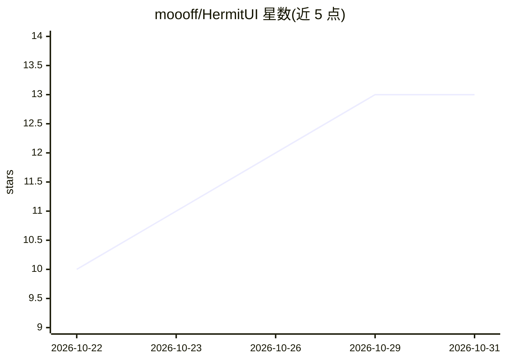

# moooff/HermitUI

⭐ 13 · HTML · AGPL-3.0 · 推送 2026-10-29 · [GitHub](https://github.com/moooff/HermitUI) · 个人维护

**单 HTML 文件浏览器本地 LLM 聊天与 Agent 界面，零安装零痕迹**

由四个单 HTML 文件应用组成：聊天客户端（可连接任何 OpenAI 兼容服务器）、浏览器内运行 GGUF 模型的离线版（wllama 即 WebAssembly 版 llama.cpp，支持 WebGPU）、在标签页内用 Pyodide 写写并运行 Python 的 Agent（每步需用户批准、可撤销），以及清理 AI 文本痕迹的 Cleaner。面向隔离网机器、锁定企业网络、共用电脑等无痕场景：不使用 localStorage/IndexedDB/cookie，模型仅驻留内存，关闭标签页即消失。

## 筛选速览

| 维度 | 判定 | 备注 |
|---|---|---|
| AI 角色 | `ai-native` | 本体是模型或模型工具 |
| 许可风险 | `viral` | AGPL-3.0 |
| 部署形态 | `None` |  |
| 模型依赖 | local-ok | 支持本地模型 |
| 硬件要求 | — | 无带数字的原话,不猜 |
| 安装摩擦 | `low` | 无编译、无系统依赖或容器化 |
| 成熟度 | — | 结构信号不足 |

## 能力要点

- 单 HTML 文件零安装，浏览器内经 wllama/WebGPU 运行 GGUF 模型
- 无任何存储与遥测，模型仅驻内存，关页即消失
- Agent 在标签页内用 Pyodide 运行 Python，每步需批准且可撤销
- 兼容任意 OpenAI 兼容服务器（LM Studio/Ollama/llama.cpp/vLLM）

## 适用场景

- 在隔离网或锁定企业网络的电脑上使用本地 LLM 聊天
- 在共用电脑上不留任何痕迹地跑模型与对话
- 让 Agent 在浏览器沙箱内写 Python 处理我投放的文件
- 用手机等另一设备访问局域网内的模型服务器

## 场景标签

`聊天机器人` `AI 助手` · 领域:对话与助手

## 证据(README 行号)

> L22: HermitUI is a chat interface that comes as one `.html` file. There is nothing to install: open the file and it runs
> L32: |**HermitUI**|Chat client for your own model server|Open|`dist/hermit-ui-standalone.html` (3 MB)|
> L33: |**HermitUI in-browser**|The same chat, plus a model that runs in the tab: no server at all|Open with Qwen3-0.6B|`d

## 星数曲线

2026-10-22 10 → 2026-10-31 13（+3）

---
*卡片 v1 · prompt 1.4 · 生成 2026-10-31 · 置信度 high · 依据 README sha `520fc40bc9a0` · [字段定义](../../DATASET.md)*
