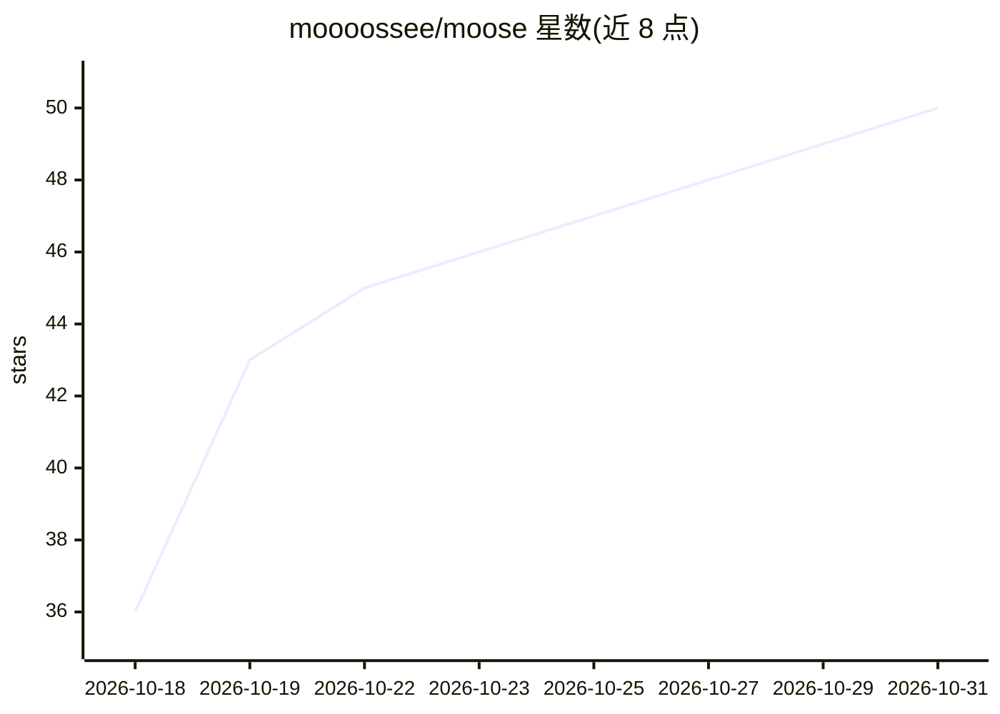

# moooossee/moose

⭐ 50 · Rust · GPL-3.0 · 推送 2026-10-29 · [GitHub](https://github.com/moooossee/moose) · [官网](https://moooossee.github.io/) · 个人维护

**Linux 原生桌面 AI 聊天应用：本地模型与云端对话**

基于 GTK4 与 libadwaita 的 Linux 原生 AI 聊天应用。用户可在应用内浏览并下载本地模型，通过 Moose 托管或已有的 Ollama 实例做本地推理，也可连接 Ollama Cloud、Groq、OpenAI、Anthropic Claude、Google Gemini 等云端服务。支持在对话中附加图片、PDF、文本等文件并维护可搜索的文档库；聊天与草稿保存在本地。提供 Local Only 模式屏蔽远程推理，云凭据存入桌面密钥环。Flatpak 为主要安装途径，原生构建需 Rust/Meson/GTK4 等依赖。

## 筛选速览

| 维度 | 判定 | 备注 |
|---|---|---|
| AI 角色 | `ai-native` | 本体是模型或模型工具 |
| 许可风险 | `viral` | GPL-3.0 |
| 部署形态 | `None` |  |
| 模型依赖 | local-ok | 支持本地模型 |
| 硬件要求 | — | 无带数字的原话,不猜 |
| 安装摩擦 | `low` | 无编译、无系统依赖或容器化 |
| 成熟度 | — | 结构信号不足 |

## 能力要点

- 应用内浏览并下载本地模型，由 Moose 托管 Ollama 做本地推理
- 对话附加图片/PDF/文本文件并维护可搜索文档库
- 支持 Ollama Cloud、Groq、OpenAI、Anthropic Claude、Google Gemini 多种云端连接
- Local Only 模式屏蔽远程推理，密钥存于桌面密钥环

## 适用场景

- 在 Linux 桌面离线与本地模型聊天
- 把 PDF、代码和图片带入 AI 对话提问
- 在同一应用内切换本地推理与云端模型

## 场景标签

`聊天机器人` · 领域:对话与助手

## 证据(README 行号)

> L7: Moose lets you chat with local AI models or an optional cloud provider in a native
> L29: - **Choose your connection.** Use Ollama managed by Moose, an existing Ollama instance,

## 星数曲线

2026-10-18 36 → 2026-10-31 50（+14）

---
*卡片 v1 · prompt 1.4 · 生成 2026-10-25 · 置信度 high · 依据 README sha `9f99c37ba2d3` · [字段定义](../../DATASET.md)*
