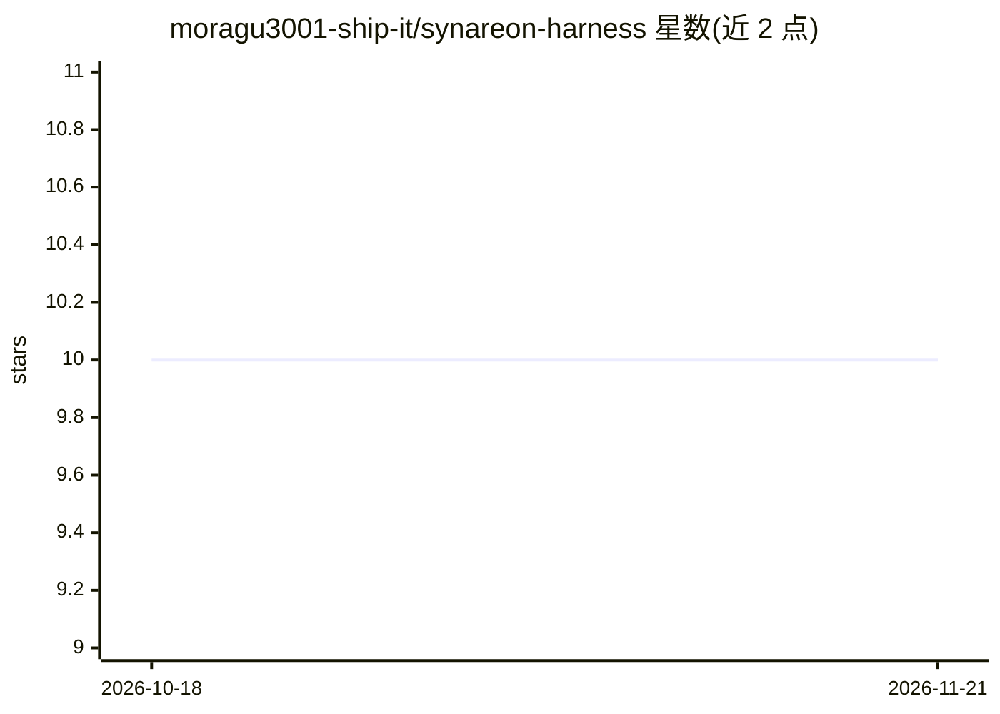

# moragu3001-ship-it/synareon-harness

⭐ 10 · Python · Apache-2.0 · 推送 2026-09-18 · [GitHub](https://github.com/moragu3001-ship-it/synareon-harness) · 个人维护

**为编码 agent 执行提供证据驱动完成性保障的约束层**

面向使用编码 agent 的开发者的 assurance 层：agent 负责探索、写码与修 bug，Synareon 管控执行边界——写入范围准入、确定性验证、证据资格判定与完成声明权限，输出 VERIFIED/FAILED/NEEDS_ATTENTION 三种终态，明确区分 agent 自称 DONE 与 Harness 判定的 COMPLETED。Public Alpha 仅支持 Codex Official Headless CLI，变异任务须显式声明允许写入集，默认超时 120 秒，未认证为生产可用。

## 筛选速览

| 维度 | 判定 | 备注 |
|---|---|---|
| AI 角色 | `ai-ecosystem` | LLM/agent 周边工具 |
| 许可风险 | `permissive` | Apache-2.0 |
| 部署形态 | `None` |  |
| 模型依赖 | — | README 未给出锁定关系 |
| 硬件要求 | — | 无带数字的原话,不猜 |
| 安装摩擦 | `low` | 无编译、无系统依赖或容器化 |
| 成熟度 | `idea` | |

## 能力要点

- 写入范围显式准入的 fail-closed 变异边界
- 确定性验证与证据资格判定，agent 自报不构成完成权威
- synareon doctor 就绪诊断与 --json 机器可读输出
- 受控 RED 资格：失败须绑定合格预期才授予修复变更权限

## 适用场景

- 让 Codex agent 改代码时核验工作是否真正完成
- 限制 agent 变更只能在声明的写入范围内
- 避免 agent 将失败静默报告为完成

## 场景标签

`编码 Agent` · 领域:编码与开发

## 证据(README 行号)

> L5: Synareon Harness is an open-source assurance layer for coding-agent execution.
> L7: Your coding agent still explores, reasons, writes code, and fixes bugs. Synareon controls the assurance boundary aro
> L365: Synareon separates **agent intelligence** from **execution assurance**.

## 星数曲线

2026-10-18 10 → 2026-11-21 10（+0）

---
*卡片 v1 · prompt 1.4 · 生成 2026-11-19 · 置信度 high · 依据 README sha `2f7f068e1750` · [字段定义](../../DATASET.md)*
