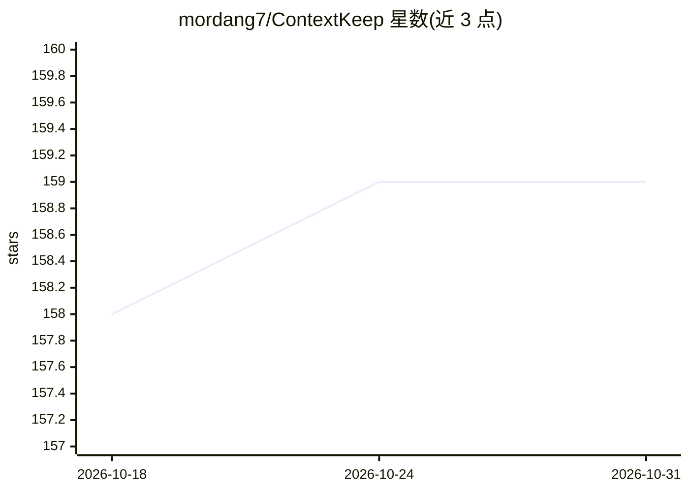

# mordang7/ContextKeep

⭐ 159 · Python · MIT · 推送 2026-09-18 · [GitHub](https://github.com/mordang7/ContextKeep) · [官网](https://github.com/mordang7/ContextKeep) · 个人维护

**为 AI agent 提供跨会话持久记忆的 MCP 服务器**

ContextKeep 是一个 MCP 服务器，为 MCP 兼容的 AI agent 提供基于 SQLite（FTS5 全文搜索）的持久化本地记忆，支持用户可编辑的多分类、编辑历史、JSON 导出，并提供 WebUI 供浏览/编辑/搜索/导出与分类管理。通过 16 个 MCP 工具暴露存储/检索/搜索/分类管理能力，支持 stdio 与 streamable HTTP（含 SSE 回退）传输。提供 Docker Compose 一键部署及经验证的备份/升级脚本。需 Python 3.10+，跨 Linux/Windows/macOS。

## 筛选速览

| 维度 | 判定 | 备注 |
|---|---|---|
| AI 角色 | `ai-ecosystem` | LLM/agent 周边工具 |
| 许可风险 | `permissive` | MIT |
| 部署形态 | `self-host` | docker 或自建部署 |
| 模型依赖 | — | README 未给出锁定关系 |
| 硬件要求 | — | 无带数字的原话,不猜 |
| 安装摩擦 | `low` | 无编译、无系统依赖或容器化 |
| 成熟度 | — | 结构信号不足 |

## 能力要点

- SQLite + FTS5 全文搜索的持久记忆存储
- 16 个 MCP 工具覆盖存储/检索/搜索/分类管理/导出
- WebUI 支持浏览、编辑、搜索、导出与分类管理
- Docker Compose 单容器部署与验证式备份升级脚本

## 适用场景

- 让 AI agent 在不同会话间保留和检索记忆
- 通过 WebUI 管理与整理 agent 的记忆分类
- 为部署在远程机器上的 agent 提供共享记忆服务

## 场景标签

`Agent 记忆` · 领域:Agent 开发

## 证据(README 行号)

> L14: **ContextKeep** gives AI agents a persistent, searchable memory they can use across sessions. V2.1 adds SQLite, ful
> L20: - Persistent local memory for MCP-compatible agents.

## 星数曲线

2026-10-18 158 → 2026-10-31 159（+1）

---
*卡片 v1 · prompt 1.4 · 生成 2026-10-22 · 置信度 mid · 依据 README sha `b90bd39cefc4` · [字段定义](../../DATASET.md)*
