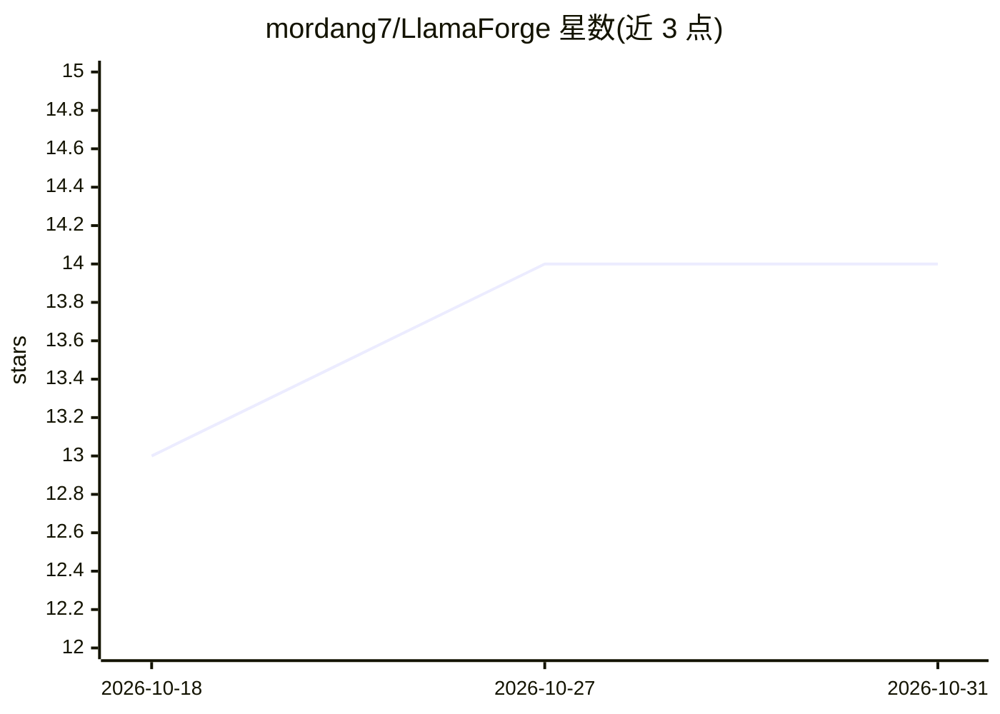

# mordang7/LlamaForge

⭐ 14 · JavaScript · 推送 2026-04-07 · [GitHub](https://github.com/mordang7/LlamaForge) · 个人维护

**llama.cpp 的图形化管理前端：检测后端并配置启动本地 LLM**

面向 llama.cpp 的 Windows 桌面 GUI：自动扫描系统中 CUDA、ROCm、Vulkan 的兼容 DLL 并只启用有效后端，支持强制指定后端（通过环境变量覆盖如 CUDA_VISIBLE_DEVICES）；递归扫描目录管理 .gguf 模型，可视化调节上下文大小、GPU 层数与线程数，生成可手动编辑的 llama-server 命令，内置 HuggingFace 模型下载入口，并在 UI 中实时流式展示服务日志与 tokens/s。安装为下载 zip 运行 exe，需用户自备 llama-server.exe 与模型。

## 筛选速览

| 维度 | 判定 | 备注 |
|---|---|---|
| AI 角色 | `ai-ecosystem` | LLM/agent 周边工具 |
| 许可风险 | `none` | — |
| 部署形态 | `desktop` | 安装包/桌面程序 |
| 模型依赖 | local-ok | 支持本地模型 |
| 硬件要求 | — | 无带数字的原话,不猜 |
| 安装摩擦 | `medium` | 含编译或系统依赖之一 |
| 成熟度 | `idea` | |

## 能力要点

- 自动检测 CUDA/ROCm/Vulkan DLL 并仅启用有效后端
- 强制后端切换（覆盖 CUDA_VISIBLE_DEVICES 等环境变量）
- 递归扫描 .gguf 模型并以可视化滑杆调节上下文/GPU 层数/线程
- 内置 HuggingFace 模型下载与实时流式日志面板

## 适用场景

- 不想用命令行启动 llama.cpp 的本地模型用户
- 在本机不同 GPU 后端（CUDA/ROCm/Vulkan）间切换测试
- 需要实时查看 tokens/s 与服务日志的本地推理场景

## 场景标签

 · 领域:LLM 基础设施/桌面工具

## 证据(README 行号)

> L12: LlamaForge is a professional-grade Graphical User Interface (GUI) for llama.cpp. It transforms the complex process 
> L30: 4. Point it to your `llama-server.exe` (part of llama.cpp) and your Model folder.

## 星数曲线

2026-10-18 13 → 2026-10-31 14（+1）

---
*卡片 v1 · prompt 1.4 · 生成 2026-10-31 · 置信度 high · 依据 README sha `1cea05fe89f4` · [字段定义](../../DATASET.md)*
