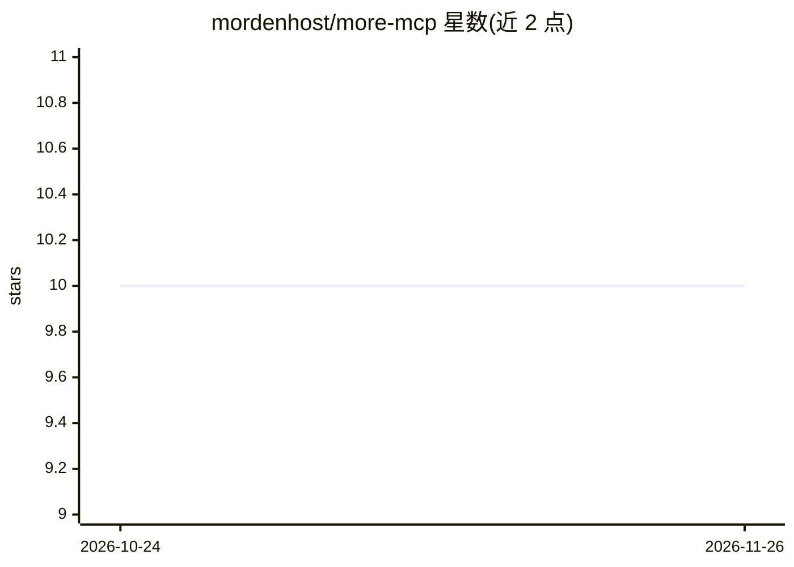

# mordenhost/more-mcp

⭐ 10 · PHP · NOASSERTION · 推送 2026-10-14 · [GitHub](https://github.com/mordenhost/more-mcp) · 组织维护

**把 WordPress 变成 MCP 服务器，供 AI 助手安全操作站点**

一个内嵌于 WordPress 的自托管 MCP 服务器插件：通过 OAuth 2.0（PKCE、刷新令牌轮换）或静态 API key 认证，向 Claude、ChatGPT、Gemini 等兼容 MCP 的客户端暴露类型化工具。默认注册 111 个常驻工具（覆盖文章、页面、媒体、评论、分类、SEO 元数据等），管理员可选择性启用插件集成工具与 11 个插件/主题生命周期工具。每次请求经过 per-IP 限速、WordPress capability 检查并记录审计日志；凭证与日志全部留在本地数据库。要求 PHP 7.4+、WordPress 5.8+、HTTPS 与非 Plain 固定链接。

## 筛选速览

| 维度 | 判定 | 备注 |
|---|---|---|
| AI 角色 | `ai-ecosystem` | LLM/agent 周边工具 |
| 许可风险 | `none` | NOASSERTION |
| 部署形态 | `None` |  |
| 模型依赖 | local-ok | 支持本地模型 |
| 硬件要求 | — | 无带数字的原话,不猜 |
| 安装摩擦 | `medium` | 含编译或系统依赖之一 |
| 成熟度 | — | 结构信号不足 |

## 能力要点

- 111 个常驻工具，另有可开关的插件集成与 11 个生命周期工具
- OAuth 2.0 + PKCE 与静态 API key 双认证，带限速与审计日志
- 数据不出本地数据库：无许可证服务器、无遥测
- 同时暴露原生 MCP 端点、经典 REST API 与 WordPress Abilities API（6.9+）

## 适用场景

- 让 Claude 或 ChatGPT 直接管理 WordPress 文章、媒体与评论
- 以受控权限把站点运维交给 AI 编码助手
- 在自有服务器上记录并审计 AI 对站点的每次操作

## 场景标签

 · 领域:CMS/AI 助手接入基础设施

## 证据(README 行号)

> L9: Mordenhost MCP is a self-hosted Model Context Protocol server built into WordPress by Mordenhost. Claude, ChatGPT, G
> L11: Where a bare MCP bridge stops at exposing functions, Mordenhost MCP is built for sites that are actually in product
> L71: Mordenhost MCP is fully featured in its free, GPL-licensed release. There is no Pro version &mdash; all tools ship 

## 星数曲线

2026-10-24 10 → 2026-11-26 10（+0）

---
*卡片 v1 · prompt 1.4 · 生成 2026-11-19 · 置信度 high · 依据 README sha `7baeaf277804` · [字段定义](../../DATASET.md)*
