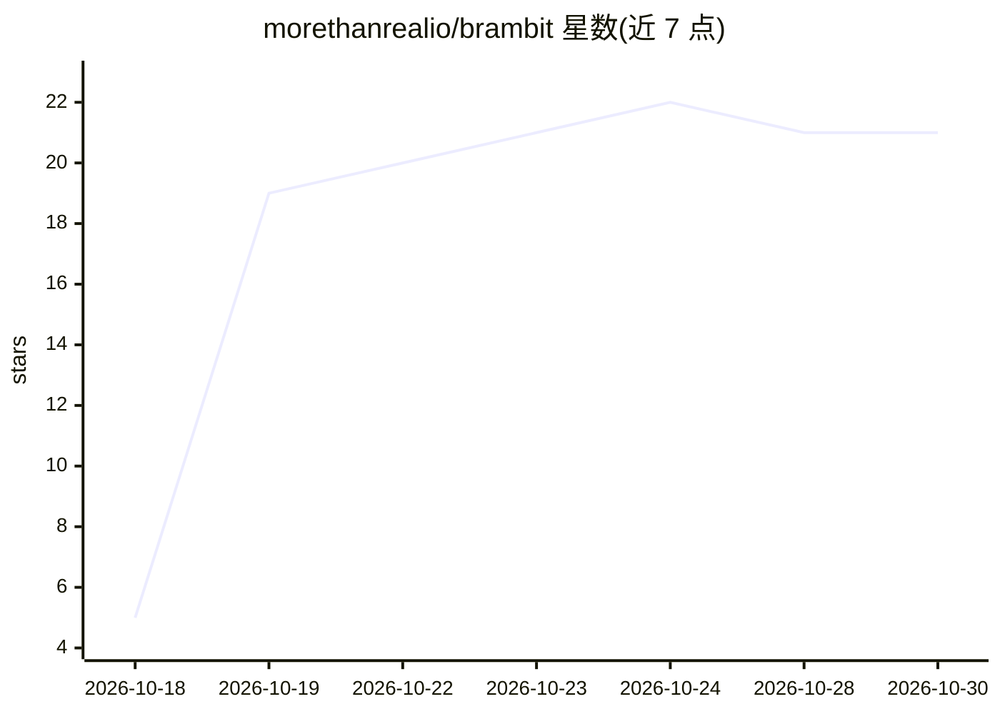

# morethanrealio/brambit

⭐ 21 · JavaScript · AGPL-3.0 · 推送 2026-10-29 · [GitHub](https://github.com/morethanrealio/brambit) · 组织维护

**自托管多人个人 AI 助手引擎：一台服务器，每人的独立助手**

在自有服务器上运行的 AI 助手引擎：安装者配置一次，家庭/团队/公司成员各获账号，通过网页、Telegram、WhatsApp、邮件、Slack 与助手对话。助手具备记忆、连接器（Google/Microsoft/GitHub/远程 MCP）、沙箱代码执行、托管小应用与定时例程。自带模型：在 models.yaml 中按任务选择 OpenAI 兼容服务或 Gemini 并填自己的 key。写操作需确认，每账号独立容器沙箱；支持插件扩展。AGPL-3.0，由 More Than Real 团队维护，同时是其托管服务 Brambs 的引擎。

## 筛选速览

| 维度 | 判定 | 备注 |
|---|---|---|
| AI 角色 | `ai-native` | 本体是模型或模型工具 |
| 许可风险 | `viral` | AGPL-3.0 |
| 部署形态 | `None` |  |
| 模型依赖 | local-ok | 支持本地模型 |
| 硬件要求 | — | 无带数字的原话,不猜 |
| 安装摩擦 | `low` | 无编译、无系统依赖或容器化 |
| 成熟度 | — | 结构信号不足 |

## 能力要点

- 单服务器多账号，账号间数据隔离有自动化测试校验
- 网页/Telegram/WhatsApp/邮件/Slack 五个渠道对话
- 按任务（chat/image/coding/memory 等）在 models.yaml 选模型，支持 fallback
- 写/发送类操作先确认，代码在每账号独立容器的隔离沙箱主机运行

## 适用场景

- 家庭或团队共用一台服务器，每人有自己的 AI 助手和记忆
- 让助手在 Telegram/WhatsApp/Slack 等日常渠道回复我
- 接入 Google/GitHub 等连接器并让助手代办有确认的操作

## 场景标签

`Agent 框架` `AI 助手` · 领域:Agent 开发

## 证据(README 行号)

> L13: Brambit is software that runs on your own server and gives every person in a family,
> L19: People chat with their assistants in a web app and on Telegram, WhatsApp, email and
> L22: scheduled routines. You pick the model: any provider compatible with the OpenAI API,

## 星数曲线

2026-10-18 5 → 2026-10-30 21（+16）

---
*卡片 v1 · prompt 1.4 · 生成 2026-10-27 · 置信度 high · 依据 README sha `cad31bdb02dc` · [字段定义](../../DATASET.md)*
