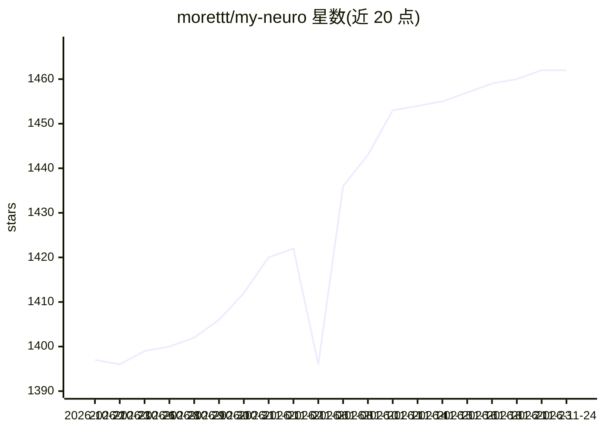

# morettt/my-neuro

⭐ 1,462 · JavaScript · MIT · 推送 2026-11-07 · [GitHub](https://github.com/morettt/my-neuro) · 个人维护 · 中文 README

**可定制的 AI 桌面陪伴角色：语音对话、记忆与形象可塑**

用于在桌面端构建个人 AI 伙伴的项目：支持自定义性格、声音（默认基于 GPT-SoVITS 的 TTS 训练）与 Live2D 形象替换，提供全本地推理的低延迟语音对话、字幕同步、实时打断、长期记忆、图像识别、联网搜索、B 站直播、AI 唱歌/讲课、游戏陪玩（已接入我的世界、galgame）及安卓手机应用。部署流程发布于项目官网，Linux/Wayland 可从源码运行；项目自称当前实现约 30% 功能，情感状态等能力仍在开发中。

## 筛选速览

| 维度 | 判定 | 备注 |
|---|---|---|
| AI 角色 | `ai-native` | 本体是模型或模型工具 |
| 许可风险 | `permissive` | MIT |
| 部署形态 | `None` |  |
| 模型依赖 | — | README 未给出锁定关系 |
| 硬件要求 | — | 无带数字的原话,不猜 |
| 安装摩擦 | `low` | 无编译、无系统依赖或容器化 |
| 成熟度 | `idea` | |

## 能力要点

- 全本地推理，对话延迟 1 秒以下，字幕与语音同步输出
- 支持开源模型微调/本地部署与闭源模型接入双路径
- 长期记忆、图像识别、MCP 工具接入与实时打断
- 可替换 Live2D 形象并训练声音模型（默认 GPT-SoVITS）

## 适用场景

- 在桌面端养一个可语音对话、有长期记忆的 AI 陪伴角色
- 自定义角色的性格、声线与 Live2D 形象
- 让 AI 陪玩我的世界、galgame 等游戏或在 B 站直播

## 场景标签

`语音 Agent` `AI 助手` · 领域:对话与助手

## 证据(README 行号)

> L18: my-neuro的目标是打造专属个人的 AI 角色,打造出逼近真人的AI伙伴 - 通过您的数据印记,塑造出心目中理想的 TA 的形象。
> L29: - [x] 超低延迟：全本地推理，对话延迟在1秒以下
> L38: - [x] 声音模型（TTS）训练支持，默认使用gpt-sovits开源项目

## 星数曲线

2026-10-22 1,397 → 2026-11-24 1,462（+65）

---
*卡片 v1 · prompt 1.4 · 生成 2026-11-23 · 置信度 high · 依据 README sha `94b13efb61fe` · [字段定义](../../DATASET.md)*
