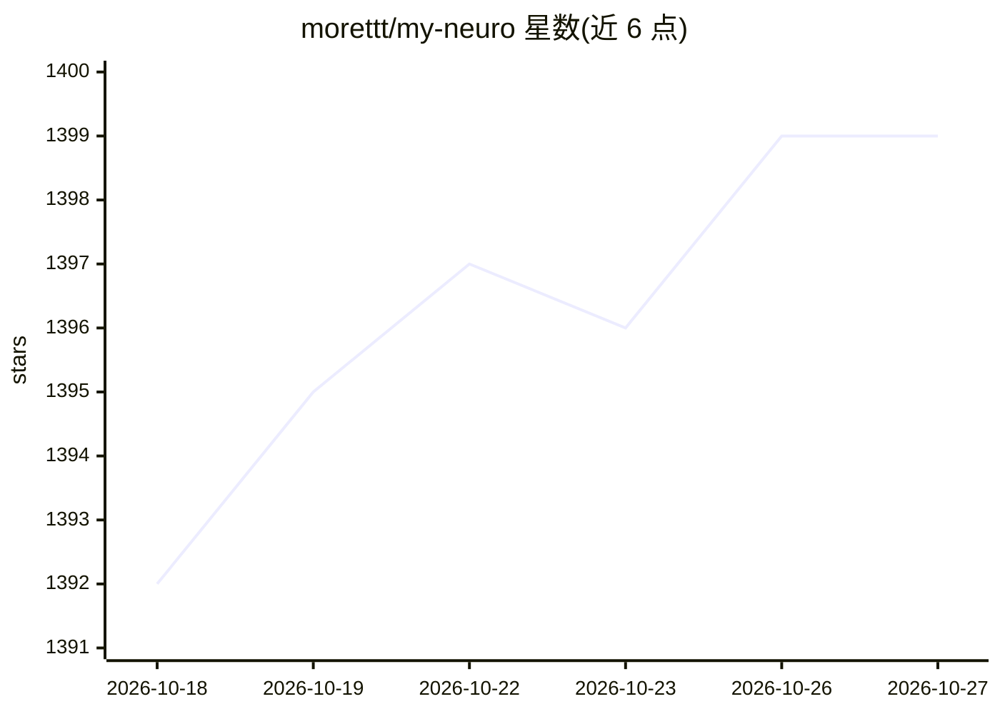

# morettt/my-neuro

⭐ 1,399 · JavaScript · MIT · 推送 2026-10-26 · [GitHub](https://github.com/morettt/my-neuro) · 个人维护 · 中文 README

**可定制 Live2D 桌面 AI 陪伴角色，支持语音对话与本地推理**

受 Neuro-sama 启发的 AI 桌面伴侣项目：提供 Live2D 形象替换、语音克隆（默认接入 GPT-SoVITS）、性格设定、长期记忆（引用 MemOS）、视觉识别、AI 唱歌与讲课等功能，全本地推理下对话延迟低于 1 秒。支持开源模型微调/本地部署与闭源模型接入，LLM-studio 文件夹含本地推理与微调指导。部署流程见官网，另附带角色“肥牛”，支持哔哩哔哩直播与安卓 app 对话。项目自述完成度约 30%，多个功能仍在计划中。

## 筛选速览

| 维度 | 判定 | 备注 |
|---|---|---|
| AI 角色 | `ai-native` | 本体是模型或模型工具 |
| 许可风险 | `permissive` | MIT |
| 部署形态 | `None` |  |
| 模型依赖 | — | README 未给出锁定关系 |
| 硬件要求 | — | 无带数字的原话,不猜 |
| 安装摩擦 | `low` | 无编译、无系统依赖或容器化 |
| 成熟度 | `idea` | |

## 能力要点

- Live2D 形象替换与表情动作联动
- TTS 声音模型训练（默认 GPT-SoVITS）
- 全本地推理对话延迟低于 1 秒，支持开源模型微调与闭源模型接入
- 长期记忆、视觉识别、哔哩哔哩直播、游戏陪玩等功能

## 适用场景

- 打造自己的 Live2D 桌面 AI 陪伴角色
- 用本地 LLM 推理或微调实现低延迟语音对话
- 在哔哩哔哩进行 AI 角色直播

## 场景标签

`语音 Agent` `AI 助手` `语音合成` · 领域:对话与助手

## 证据(README 行号)

> L16: my-neuro的目标是打造专属个人的 AI 角色,打造出逼近真人的AI伙伴 - 通过您的数据印记,塑造出心目中理想的 TA 的形象。
> L29: - [x] 超低延迟：全本地推理，对话延迟在1秒以下

## 星数曲线

2026-10-18 1,392 → 2026-10-27 1,399（+7）

---
*卡片 v1 · prompt 1.4 · 生成 2026-10-21 · 置信度 high · 依据 README sha `d84e4b7fe7f1` · [字段定义](../../DATASET.md)*
