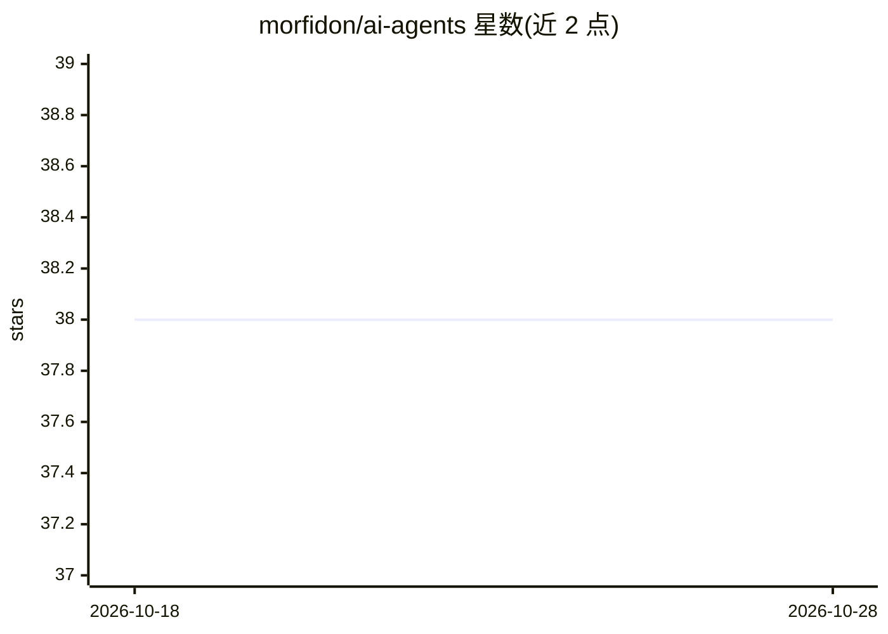

# morfidon/ai-agents

⭐ 38 · 推送 2026-04-04 · [GitHub](https://github.com/morfidon/ai-agents) · 个人维护

**50+ 个代码库审计专用 AI agent 定义集合**

面向代码审计的 AI agent 策展仓库：收录 50 余个各执行单一分析任务的 agent 定义，按核心代码完整性、性能、架构、依赖供应链、构建交付、安全合规、跨平台、测试文档、聚合报告等 10 个阶段组织。每个 agent 遵循统一方法论（目标、方法、检查项、输出格式、严重度与置信度框架），全部只读不改代码，输出结构化审计发现。项目自述不是通用 agent 框架，未提供安装命令或运行入口。目标读者为开发团队、DevOps、安全与 QA 团队及架构师。

## 筛选速览

| 维度 | 判定 | 备注 |
|---|---|---|
| AI 角色 | `ai-knowledge` | 知识聚合/清单类 |
| 许可风险 | `none` | — |
| 部署形态 | `None` |  |
| 模型依赖 | — | README 未给出锁定关系 |
| 硬件要求 | — | 无带数字的原话,不猜 |
| 安装摩擦 | `low` | 无编译、无系统依赖或容器化 |
| 成熟度 | — | 结构信号不足 |

## 能力要点

- 50+ 窄域审计 agent，按 10 个分析阶段组织
- 统一方法论模板：目标/方法/检查项/输出格式/严重度与置信度
- 只读原则：仅分析与报告，不修改代码
- 覆盖安全漏洞、架构异味、测试缺口、文档漂移、供应链完整性等类别

## 适用场景

- 系统性排查代码库的安全与架构问题
- 为测试覆盖与文档一致性做审计
- 把审计发现按严重度排序以决定修复优先级

## 场景标签

`代码审查` `精选清单` · 领域:编码与开发

## 证据(README 行号)

> L17: This project is **not another agent framework**.
> L19: Instead of building a generic AI assistant, this repo focuses on **very narrow agents** that each perform a specifi
> L123: Each agent follows a consistent methodology:

## 星数曲线

2026-10-18 38 → 2026-10-28 38（+0）

---
*卡片 v1 · prompt 1.4 · 生成 2026-10-25 · 置信度 mid · 依据 README sha `d5adee77e0c1` · [字段定义](../../DATASET.md)*
