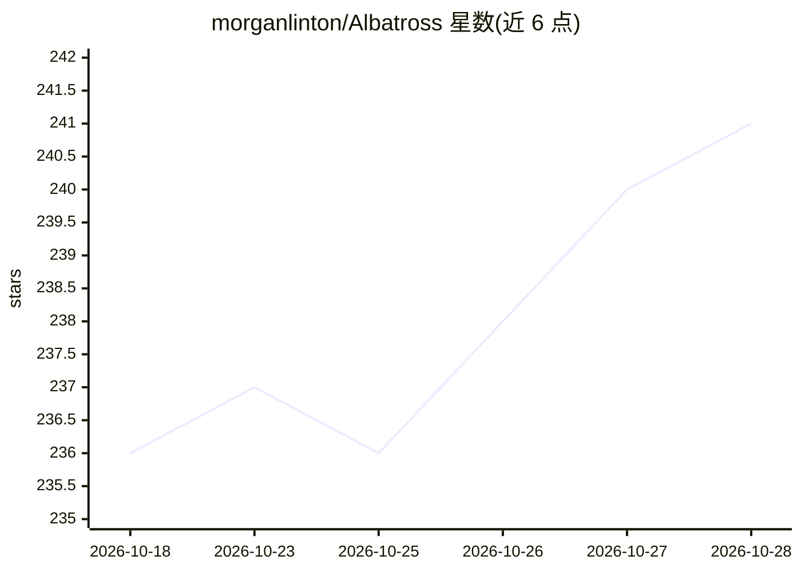

# morganlinton/Albatross

⭐ 241 · Rust · MIT · 推送 2026-10-05 · [GitHub](https://github.com/morganlinton/Albatross) · [官网](https://albatross.sh) · 个人维护

**终端优先的 AI 编码代理：自带密钥接入本地或云端模型**

用 Rust 编写的终端 TUI 编码代理：内置读/改/grep/shell/跑测试等工具链，支持通过 API 密钥接入 Anthropic、OpenAI、OpenRouter，或连接 Ollama、LM Studio、MLX、llama.cpp 等本地模型，可在会话中用 /provider 切换。提供逐轮成本显示、多模型透明路由打分、计划-评审迭代循环、会话分支与真实撤销、MCP 服务器接入、Agent Skills 与可嵌入 Rust SDK。限制：一次仅连接一个 provider；Grok OAuth 代理固定为 xAI 官方主机。安装途径为 Homebrew、cargo 或源码构建。

## 筛选速览

| 维度 | 判定 | 备注 |
|---|---|---|
| AI 角色 | `ai-native` | 本体是模型或模型工具 |
| 许可风险 | `permissive` | MIT |
| 部署形态 | `library` | 以包/库形式分发 |
| 模型依赖 | local-ok | 支持本地模型 |
| 硬件要求 | — | 无带数字的原话,不猜 |
| 安装摩擦 | `medium` | 含编译或系统依赖之一 |
| 成熟度 | — | 结构信号不足 |

## 能力要点

- 同一 TUI 内切换 9 种本地/云端 provider（/provider 命令）
- 多模型路由打分：成本估算、策略限制与理由展示
- 会话分支（/path fork）、生成→评审迭代与真实撤销（/undo）
- MCP 服务器原生接入与可安装 npm/Git 扩展包、Agent Skills

## 适用场景

- 在终端里让 AI 代理读写代码、跑测试并提交 PR
- 本地 Ollama/llama.cpp 模型与云端模型间按任务切换以控成本
- 用独立评审代理对生成结果按评分标准迭代

## 场景标签

`编码 Agent` · 领域:编码与开发

## 证据(README 行号)

> L29: A coding agent that lives in your terminal. Bring your own **API key**
> L30: (OpenAI or OpenRouter) or point it at a **local model** (Ollama, LM Studio,

## 星数曲线

2026-10-18 236 → 2026-10-28 241（+5）

---
*卡片 v1 · prompt 1.4 · 生成 2026-10-22 · 置信度 high · 依据 README sha `857e5c6dd4a9` · [字段定义](../../DATASET.md)*
