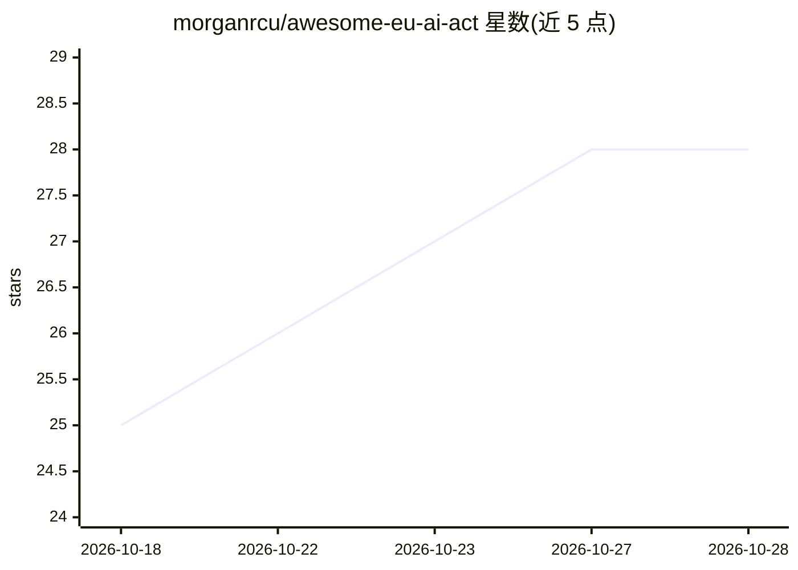

# morganrcu/awesome-eu-ai-act

⭐ 28 · 推送 2026-09-26 · [GitHub](https://github.com/morganrcu/awesome-eu-ai-act) · 个人维护

**欧盟 AI 法案合规与 AI 治理工具策展清单**

面向 AI 合规与治理的策展清单，收录开发者工具与 SDK、风险评估分类工具、治理平台、监控观测、红队测试、证据格式（OSCAL/CycloneDX ML BOM/Croissant）、AI 保障框架与标准（JTC 21 协调标准）等资源。README 说明了欧盟 AI 法案关键时间节点（2024/8/1 生效、Digital Omnibus 调整高风险系统截止日期），并标注部分条目为 demo-only。定位是帮助工程师生成法律要求的合规证据。接受 PR 贡献。

## 筛选速览

| 维度 | 判定 | 备注 |
|---|---|---|
| AI 角色 | `ai-knowledge` | 知识聚合/清单类 |
| 许可风险 | `none` | — |
| 部署形态 | `library` | 以包/库形式分发 |
| 模型依赖 | — | README 未给出锁定关系 |
| 硬件要求 | — | 无带数字的原话,不猜 |
| 安装摩擦 | `low` | 无编译、无系统依赖或容器化 |
| 成熟度 | — | 结构信号不足 |

## 能力要点

- 按 8+ 个类别组织：开发工具、风险评估、治理平台、监控、红队测试、证据格式、保障框架、标准
- 标注各条目的开源许可与安装方式（部分提供 pip install 命令）
- 说明 EU AI Act 与 Digital Omnibus (Regulation (EU) 2026/1744) 的合规时间线
- demo-only 条目单独标注以区分可自行评估的产品

## 适用场景

- 为 AI 系统合规工作查找工具与框架
- 了解 EU AI Act 各条款对应的证据格式与标准
- 对比 AI 治理平台与监控/红队测试工具

## 场景标签

`精选清单` · 领域:学习与行业

## 证据(README 行号)

> L3: > A curated list of tools, frameworks, standards, and resources for **AI Assurance** and EU AI Act compliance.
> L13: ## Contents

## 星数曲线

2026-10-18 25 → 2026-10-28 28（+3）

---
*卡片 v1 · prompt 1.4 · 生成 2026-10-26 · 置信度 mid · 依据 README sha `d88e53a1e8ab` · [字段定义](../../DATASET.md)*
