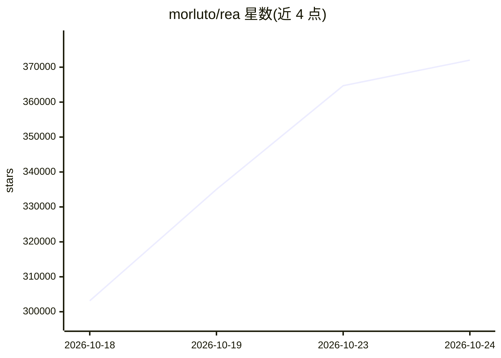

# morluto/rea

⭐ 377,057 · TypeScript · MIT · 推送 2026-10-24 · [GitHub](https://github.com/morluto/rea) · [官网](https://rea.tools) · 组织维护

**面向 AI agent 的逆向工程 MCP 工具集：分析二进制、应用与运行时行为**

REA 是一个 MCP server 与 CLI 工具集，把逆向分析工具接入 AI agent（Claude Code、Codex、Cursor、Gemini CLI 等）与终端。它支持检查原生二进制、JavaScript/Electron 应用、.NET 程序集、网站、Android APK、固件、WASM、EVM 字节码等目标，返回带证据与局限说明的分析结果。原生分析可配合 Hopper、Ghidra 或 IDA；静态 JS/.NET 检查无需原生分析引擎。需要 Node.js 22.19+/24.11+/26+ 与 npm，通过 npx 或 npm 全局安装。

## 筛选速览

| 维度 | 判定 | 备注 |
|---|---|---|
| AI 角色 | `ai-ecosystem` | LLM/agent 周边工具 |
| 许可风险 | `permissive` | MIT |
| 部署形态 | `library` | 以包/库形式分发 |
| 模型依赖 | — | README 未给出锁定关系 |
| 硬件要求 | — | 无带数字的原话,不猜 |
| 安装摩擦 | `low` | 无编译、无系统依赖或容器化 |
| 成熟度 | — | 结构信号不足 |

## 动量与使用信号

- 维护:`active` — 距上次 push 0.6 天,年发版 37,259 位贡献者
- 涨星:近 1 天 **+25,460**(自 20261016 起算)
- 安装:npm 包 `rea-agents` 月下载 346,782
- 平台:WINDOWS / LINUX · 协议:MCP

## 能力要点

- 覆盖原生二进制、Electron/JS、.NET、Android APK、固件、WASM、EVM 字节码等多类目标
- 以 MCP server 形式接入 agent，同时提供终端 CLI 命令
- 分析结果附带证据与局限说明
- 原生分析可复用已有 Hopper/Ghidra/IDA 安装

## 适用场景

- 让 AI agent 在无源码情况下调查某个应用功能如何实现并复现到自己的项目
- 逆向分析原生二进制、Electron 应用或 Android APK 提取结构与方法
- 在终端用 CLI 分析解包后的 JavaScript 应用目录或 ASAR

## 场景标签

 · 领域:逆向工程/开发者工具

## 证据(README 行号)

> L41: REA connects your agent to tools for inspecting native binaries, JavaScript and Electron apps, .NET assemblies, and
> L139: Your agent calls REA through MCP to inspect the target and trace relevant code.

## 星数曲线

2026-10-18 303,126 → 2026-10-24 372,009（+68,883）

---
*卡片 v1 · prompt 1.4 · 生成 2026-10-20 · 置信度 high · 依据 README sha `5b9c58d30346` · [字段定义](../../DATASET.md)*
