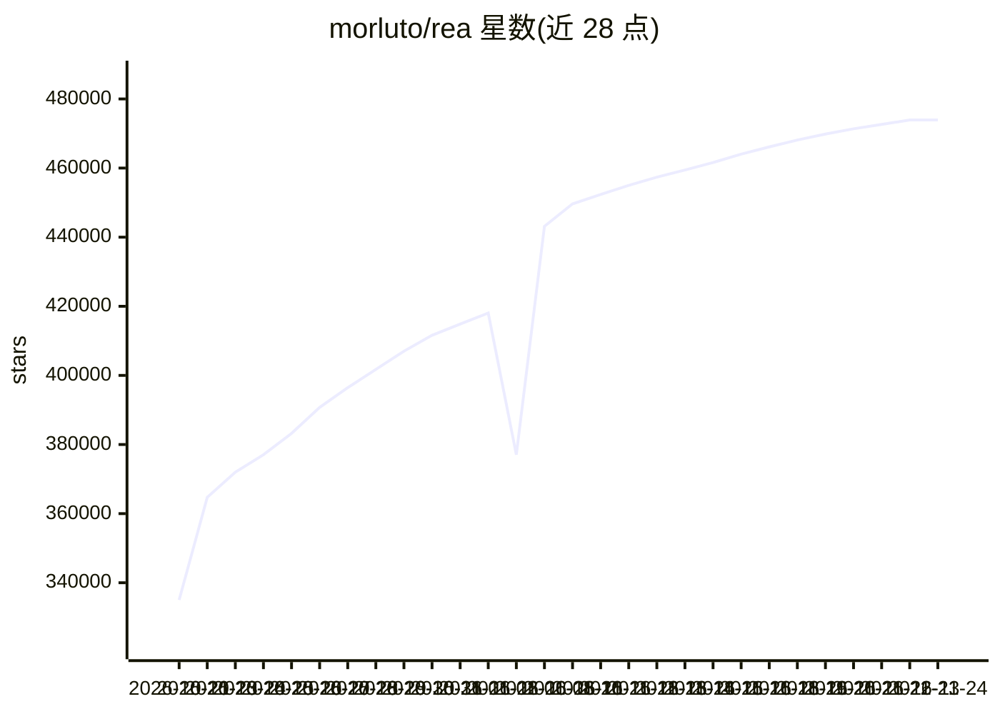

# morluto/rea

⭐ 473,910 · TypeScript · MIT · 推送 2026-11-22 · [GitHub](https://github.com/morluto/rea) · [官网](https://rea.tools) · 组织维护

**面向逆向工程 agent 的 MCP 工具集，覆盖二进制到应用行为**

REA 通过 MCP 将用户的 agent 连接到一组检查工具，可分析原生二进制、JavaScript/Electron 应用、.NET 程序集、网站、Android 应用、固件及录制的运行时与网络活动；同样提供 CLI 供终端直接使用。原生反编译依赖 Hopper、Ghidra、IDA 或 Kuna 作为分析引擎（setup 可在批准后安装 Hopper），静态 JavaScript/.NET 分析无需引擎。分析在本地运行，结果附带证据与局限说明，支持从录制会话构建 RL 环境。

## 筛选速览

| 维度 | 判定 | 备注 |
|---|---|---|
| AI 角色 | `ai-ecosystem` | LLM/agent 周边工具 |
| 许可风险 | `permissive` | MIT |
| 部署形态 | `library` | 以包/库形式分发 |
| 模型依赖 | — | README 未给出锁定关系 |
| 硬件要求 | — | 无带数字的原话,不猜 |
| 安装摩擦 | `low` | 无编译、无系统依赖或容器化 |
| 成熟度 | — | 结构信号不足 |

## 动量与使用信号

- 维护:`active` — 距上次 push 0.6 天,年发版 37,259 位贡献者
- 涨星:近 1 天 **+25,460**(自 20261016 起算)
- 安装:npm 包 `rea-agents` 月下载 346,782
- 平台:WINDOWS / LINUX · 协议:MCP

## 能力要点

- 提供 MCP 服务器与 CLI 两种使用方式，分析在本地运行
- 支持原生二进制、JavaScript/Electron、.NET、Android、固件等目标类型
- 原生反编译可接入 Hopper/Ghidra/IDA/Kuna 四种引擎
- 结果包含证据与结论局限，可从录制会话构建 RL 环境

## 适用场景

- 让 agent 分析无源码应用的功能实现并复现类似特性
- 从 x86/16 位指令恢复计算逻辑并验证 C/C++ 重建
- 对自有或授权软件做互操作性研究与软件保存

## 场景标签

`网络安全` · 领域:学习与行业

## 证据(README 行号)

> L6: ### One MCP for reverse engineering across binaries, applications, and runtime behavior.
> L42: REA connects your agent to tools for inspecting native binaries, JavaScript and Electron apps, .NET assemblies, and
> L174: Any agent that supports local MCP servers. Setup configures the

## 星数曲线

2026-10-21 335,016 → 2026-11-24 473,910（+138,894）

---
*卡片 v1 · prompt 1.4 · 生成 2026-11-22 · 置信度 high · 依据 README sha `db9e24a94503` · [字段定义](../../DATASET.md)*
