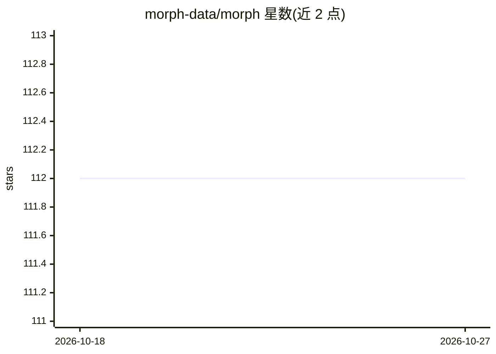

# morph-data/morph

⭐ 112 · Python · Apache-2.0 · 推送 2026-06-05 · [GitHub](https://github.com/morph-data/morph) · [官网](https://www.morph-data.io/) · 组织维护

**Python+Markdown 全栈框架，用于构建和部署 AI 内部应用**

以 Python 为中心的全栈框架，开发者用 Python 和 SQL 编写 AI 工作流并赋予别名，再通过 .mdx 文件（每个文件对应一个应用页面）用预置组件或自定义 React 组件连接工作流，无需 HTML/CSS 即可生成界面。支持开发服务器本地运行，也提供托管云用于部署、用户认证与安全数据连接。通过 pip 安装 morph-data 包，三条命令即可启动项目，采用 Apache 2.0 许可。

## 筛选速览

| 维度 | 判定 | 备注 |
|---|---|---|
| AI 角色 | `ai-ecosystem` | LLM/agent 周边工具 |
| 许可风险 | `permissive` | Apache-2.0 |
| 部署形态 | `library` | 以包/库形式分发 |
| 模型依赖 | — | README 未给出锁定关系 |
| 硬件要求 | — | 无带数字的原话,不猜 |
| 安装摩擦 | `low` | 无编译、无系统依赖或容器化 |
| 成熟度 | — | 结构信号不足 |

## 能力要点

- Python/SQL 工作流与 MDX 页面组件化的应用构建方式
- 预置组件与自定义 React/CSS 扩展 UI
- pip 安装后三条命令完成项目创建与启动
- 提供托管云用于部署、用户认证与数据连接

## 适用场景

- 快速搭建带聊天等 AI 能力的内部工具
- 用 Python 与 SQL 组合构建 AI 工作流并配界面
- 部署和管理 AI 应用到生产环境

## 场景标签

`数据分析` `工作流自动化` · 领域:效率与自动化

## 证据(README 行号)

> L5: Morph is a python-centric full-stack framework for building and deploying AI apps.
> L38: 1. Develop the AI workflow in Python and give it an alias.

## 星数曲线

2026-10-18 112 → 2026-10-27 112（+0）

---
*卡片 v1 · prompt 1.4 · 生成 2026-10-23 · 置信度 high · 依据 README sha `04651b8d9267` · [字段定义](../../DATASET.md)*
