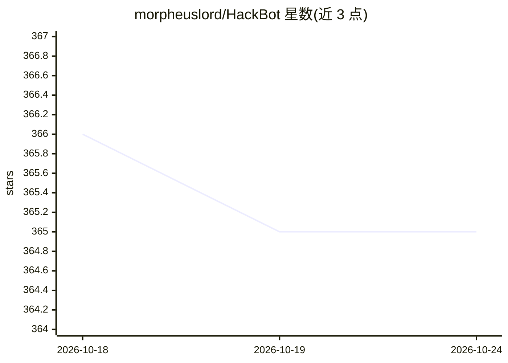

# morpheuslord/HackBot

⭐ 365 · Python · 推送 2026-09-19 · [GitHub](https://github.com/morpheuslord/HackBot) · 个人维护

**面向网络安全学生的多 agent 网络安全研究与代码分析聊天应用**

基于 pydantic-ai 的多 agent 网络安全终端应用：编排 agent 规划任务，并行调度研究员、SARIF 分析师、文档分析师与导师等专家 agent，产出带引用的回答；工具通过独立 MCP 服务器进程提供，agent 可经 ACP（IBM BeeAI acp-sdk）发布与发现。支持将任意文件或文件夹（SARIF 报告、源码、日志、Prowler/Nmap 输出等）作为输入做结构化分诊与分析。以 Rich 构建交互式 TUI，使用 uv 安装运行，需提供 OpenAI API key，系统提示拒绝漏洞利用/恶意软件生成请求，定位为研究与防御用途。

## 筛选速览

| 维度 | 判定 | 备注 |
|---|---|---|
| AI 角色 | `ai-native` | 本体是模型或模型工具 |
| 许可风险 | `none` | — |
| 部署形态 | `None` |  |
| 模型依赖 | — | README 未给出锁定关系 |
| 硬件要求 | — | 无带数字的原话,不猜 |
| 安装摩擦 | `low` | 无编译、无系统依赖或容器化 |
| 成熟度 | — | 结构信号不足 |

## 能力要点

- 多 agent 编排（pydantic-ai），专家 agent 并行运行并返回类型化模型
- 工具封装于独立 MCP 服务器，agent 经 ACP 发布与跨客户端调用
- SARIF 报告结构化分诊，任意文本文件/文件夹由文档分析师 agent 审查
- Rich TUI：活动树、流式回答、分诊/文件审查窗口、命令面板

## 适用场景

- 向 AI 团队询问 CVE 资讯并获取带引用来源的回答
- 对 SARIF 扫描报告做逐条发现的分诊与优先级判定
- 让文档分析师审查源码、配置、日志或扫描输出目录
- 网络安全课程中演示 agent 系统的编排与工具调用机制

## 场景标签

`网络安全` `多智能体` · 领域:Agent 开发

## 证据(README 行号)

> L11: Agentic rewrite of HackBot: a teaching demo of a real
> L14: * **Multi-agent orchestration** with pydantic-ai: an *orchestrator* agent
> L23: * **Any file or folder as input**: SARIF reports get structured triage; any other text file (source

## 星数曲线

2026-10-18 366 → 2026-10-24 365（-1）

---
*卡片 v1 · prompt 1.4 · 生成 2026-10-21 · 置信度 high · 依据 README sha `766e4dd274f1` · [字段定义](../../DATASET.md)*
