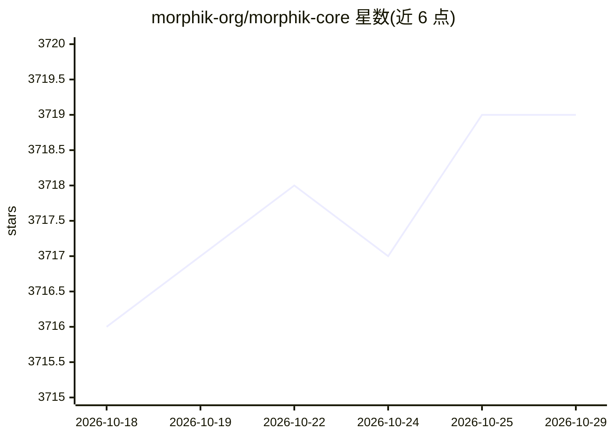

# morphik-org/morphik-core

⭐ 3,719 · Python · NOASSERTION · 推送 2026-10-26 · [GitHub](https://github.com/morphik-org/morphik-core) · [官网](https://morphik.ai/docs) · 组织维护

**面向开发者的多模态检索引擎，处理图文文档的存取与检索**

Morphik Core 是一个开源（source-available，BSL 1.1）的多模态检索引擎，为构建 AI 应用的开发者提供非结构化与多模态数据的摄取、深浅层检索、转换与管理工具。采用 ColPali 等技术支持对图像、PDF、视频的视觉内容检索，提供元数据抽取（边界框、分类等）及 Google Suite、Slack、Confluence 集成。访问方式包括 Python SDK、REST API、Web Console 与 MCP，可注册 dev.morphik.ai 免费层使用，也可自托管（官方对自托管不提供完整支持）。

## 筛选速览

| 维度 | 判定 | 备注 |
|---|---|---|
| AI 角色 | `ai-ecosystem` | LLM/agent 周边工具 |
| 许可风险 | `none` | NOASSERTION |
| 部署形态 | `library` | 以包/库形式分发 |
| 模型依赖 | — | README 未给出锁定关系 |
| 硬件要求 | — | 无带数字的原话,不猜 |
| 安装摩擦 | `low` | 无编译、无系统依赖或容器化 |
| 成熟度 | — | 结构信号不足 |

## 能力要点

- 基于 ColPali 等技术的多模态检索，单一端点搜索图像/PDF/视频
- 文档元数据抽取（边界框、标注、分类）
- 提供 Python SDK、REST API、Web Console 与 MCP 四种访问方式
- 支持 Google Suite、Slack、Confluence 等集成

## 适用场景

- 为 LLM 应用接入多模态文档检索能力
- 搜索图表、技术图纸等视觉丰富的文档内容
- 统一管理非结构化数据的摄取与查询流程

## 场景标签

`RAG` `多模态` · 领域:知识与检索

## 证据(README 行号)

> L11: > skilled nursing and senior living operators. **Morphik Core** is the
> L34: - Multimodal Search: We employ techniques such as ColPali to build search that actually *understands* the visual co

## 星数曲线

2026-10-18 3,716 → 2026-10-29 3,719（+3）

---
*卡片 v1 · prompt 1.4 · 生成 2026-10-20 · 置信度 mid · 依据 README sha `6757ec1130ae` · [字段定义](../../DATASET.md)*
