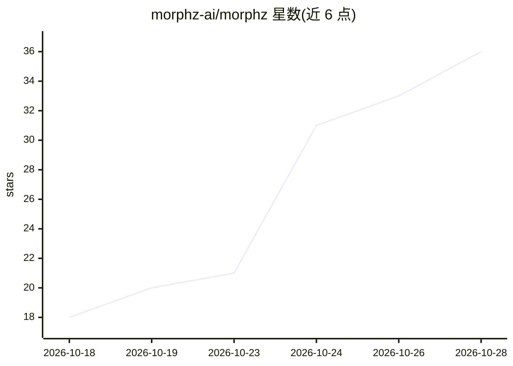

# morphz-ai/morphz

⭐ 36 · TypeScript · Apache-2.0 · 推送 2026-10-26 · [GitHub](https://github.com/morphz-ai/morphz) · [官网](https://morphz.ai) · 组织维护 · 中文 README

**持久认知 agent 运行时：结构化上下文+确定性事务内核**

面向持久化 agent 的运行时（Rust 实现）：以 S-表达式认知机为架构，将版本化的认知 Frame 与结构化 Context 作为模型直接评估的对象，由确定性事务内核管理事实、权限、状态、执行与恢复；通过 Objectives/Threads/Activations 与版本化事务支持可检视的并发工作。提供 CLI、嵌入式 Dashboard 与桌面/Web 应用。0.1 为源码优先的 Developer Preview，接口可能有破坏性变更；支持 macOS/Linux/Windows，Linux 沙箱依赖 Bubblewrap。由 Newvar 创建维护。

## 筛选速览

| 维度 | 判定 | 备注 |
|---|---|---|
| AI 角色 | `ai-ecosystem` | LLM/agent 周边工具 |
| 许可风险 | `permissive` | Apache-2.0 |
| 部署形态 | `None` |  |
| 模型依赖 | — | README 未给出锁定关系 |
| 硬件要求 | — | 无带数字的原话,不猜 |
| 安装摩擦 | `medium` | 含编译或系统依赖之一 |
| 成熟度 | `idea` | |

## 能力要点

- 结构化 Context 作为模型评估对象，替代增长的聊天转录
- 确定性事务内核管理事实、权限、状态与恢复
- Objectives/Threads/Activations 与版本化事务支持并发工作
- 原生 OS 沙箱的共享权限配置（workspace-write/full_access）

## 适用场景

- 构建需要持久记忆与可恢复执行的长期运行 agent
- 审计 agent 的认知轨迹与权限变更记录
- 在结构化上下文上做多线程并发的 agent 开发

## 场景标签

`Agent 框架` `Agent 记忆` · 领域:Agent 开发

## 证据(README 行号)

> L15: Morphz is an **S-Expression Cognitive Machine** built for durable agents. It makes structured
> L17: handles nondeterministic semantics; a deterministic transaction kernel owns facts, authority,
> L43: - **Context is durable state.** An Agent owns versioned cognitive Frames independently of any one

## 星数曲线

2026-10-18 18 → 2026-10-28 36（+18）

---
*卡片 v1 · prompt 1.4 · 生成 2026-10-25 · 置信度 high · 依据 README sha `01f7ad8075b8` · [字段定义](../../DATASET.md)*
