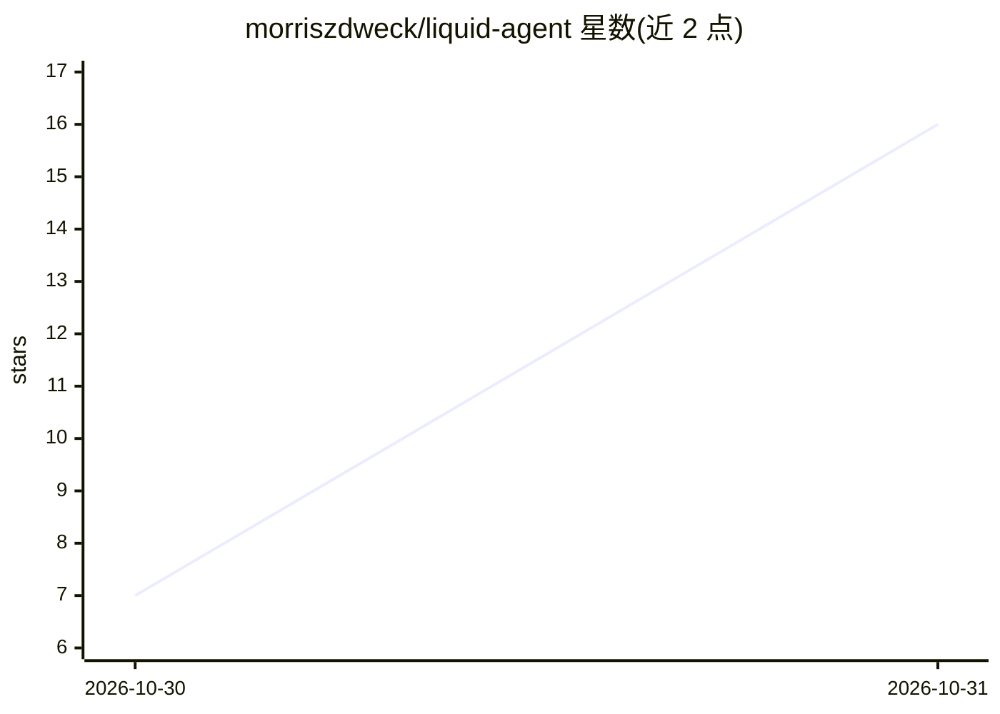

# morriszdweck/liquid-agent

⭐ 16 · JavaScript · MIT · 推送 2026-10-30 · [GitHub](https://github.com/morriszdweck/liquid-agent) · 个人维护

**macOS/Linux 本地私有 AI 代理：LFM3 双模型加语音与浏览器操作**

面向终端用户的本地运行 AI 代理：LFM3 1.7B 处理日常文本与推理，LFM3 Omni 2B 统一处理语音对话、听写、图片与屏幕视觉，Auto 200M INT4 分类器承担安全审批（三种安全模式）。可通过 Betterwright 浏览器助手点击网页，并执行命令、读写文件、定时任务与记忆。一条 curl 脚本安装，模型经 llama.cpp 引擎运行，支持 Vulkan/CPU/CUDA，可从 Hugging Face 加载自定义 GGUF。限制：Linux 上浏览器助手需 x86_64，自定义模型未经工具测试时 Full Auto 降级运行。

## 筛选速览

| 维度 | 判定 | 备注 |
|---|---|---|
| AI 角色 | `ai-native` | 本体是模型或模型工具 |
| 许可风险 | `permissive` | MIT |
| 部署形态 | `None` |  |
| 模型依赖 | local-ok | 支持本地模型 |
| 硬件要求 | — | 无带数字的原话,不猜 |
| 安装摩擦 | `medium` | 含编译或系统依赖之一 |
| 成熟度 | — | 结构信号不足 |

## 能力要点

- LFM3 1.7B 文本推理 + LFM3 Omni 2B 语音/视觉双模型分工
- Auto 200M INT4 安全分类器实现 Approve for Me 自动审批
- Betterwright 浏览器操作与命令/文件/剪贴板等本机工具
- 可从 Hugging Face 加载自定义 GGUF 模型（含 gated 仓库 HF_TOKEN 支持）

## 适用场景

- 在本机与 AI 进行可打断的语音对话和视觉问答
- 让 AI 代理在本机执行命令、操作文件和自动操作网页
- 保持数据不出本机的日常 AI 助手替代方案

## 场景标签

`AI 助手` `语音 Agent` `浏览器自动化` · 领域:效率与自动化

## 证据(README 行号)

> L3: A private AI agent for your Mac or Linux computer that runs **LFM3 1.7B** and **LFM3 Omni 2B** entirely on your comp
> L7: - **Voice chat** with LFM3 Omni 2B: it listens, thinks and talks back in one model. Talk over it to interrupt. Turn 
> L8: - **Omni where it matters**: dictation, reading answers aloud, pictures, audio and your screen all go through LFM3 O

## 星数曲线

2026-10-30 7 → 2026-10-31 16（+9）

---
*卡片 v1 · prompt 1.4 · 生成 2026-10-30 · 置信度 high · 依据 README sha `23d33229a418` · [字段定义](../../DATASET.md)*
