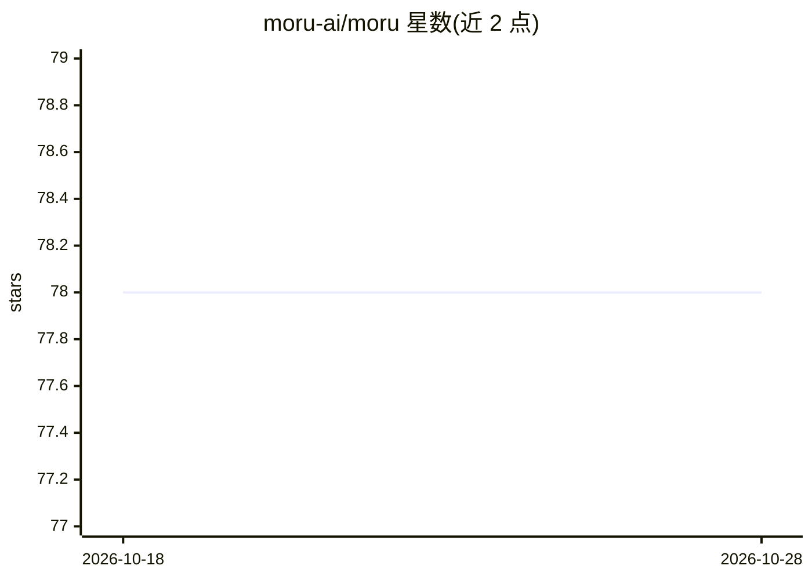

# moru-ai/moru

⭐ 78 · Python · Apache-2.0 · 推送 2026-02-07 · [GitHub](https://github.com/moru-ai/moru) · [官网](https://moru.io/docs) · 组织维护

**开源云端沙箱运行时：为 AI Agent 提供隔离 microVM**

面向 AI agent 开发者的开源云运行时：为每个会话分配独立的 Firecracker microVM，具备文件系统与 shell 访问，可在云端运行 Claude Code、Codex 等 agent 框架。外部通过 CLI 或 TypeScript/Python SDK 创建、销毁沙箱并流式读取输出；内部即普通 Linux 环境。底层基于 Docker 构建快照 + userfaultfd 懒加载实现秒级启动，采用 KVM 隔离与独立内核；项目为 E2B 的 fork。

## 筛选速览

| 维度 | 判定 | 备注 |
|---|---|---|
| AI 角色 | `ai-ecosystem` | LLM/agent 周边工具 |
| 许可风险 | `permissive` | Apache-2.0 |
| 部署形态 | `self-host` | docker 或自建部署 |
| 模型依赖 | — | README 未给出锁定关系 |
| 硬件要求 | — | 无带数字的原话,不猜 |
| 安装摩擦 | `low` | 无编译、无系统依赖或容器化 |
| 成熟度 | — | 结构信号不足 |

## 能力要点

- 每个会话独立 Firecracker microVM，含文件系统与 shell 访问
- 提供 CLI 与 TypeScript/Python SDK（创建/销毁/流式 stdout/stderr）
- Docker 构建快照 + 内存懒加载，沙箱秒级启动
- 支持自定义模板预装 agent

## 适用场景

- 在云端为 Claude Code / Codex 等 agent 提供隔离执行环境
- 为自研 agent 提供可编程的 Linux 沙箱后端
- 长时间运行的任务通过流式输出监控命令执行

## 场景标签

`Agent 框架` · 领域:Agent 开发

## 证据(README 行号)

> L3:  Open-source cloud runtime for AI agents.
> L6: Run agent harnesses like Claude Code or Codex in the cloud, giving each session its own isolated microVM with filesy

## 星数曲线

2026-10-18 78 → 2026-10-28 78（+0）

---
*卡片 v1 · prompt 1.4 · 生成 2026-10-24 · 置信度 mid · 依据 README sha `cbbc58cd5ae1` · [字段定义](../../DATASET.md)*
