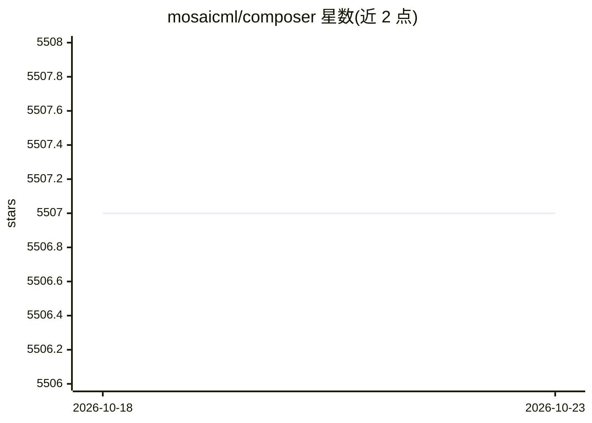

# mosaicml/composer

⭐ 5,507 · Python · Apache-2.0 · 推送 2026-04-29 · [GitHub](https://github.com/mosaicml/composer) · [官网](http://docs.mosaicml.com) · 组织维护

**基于 PyTorch 的大规模分布式深度学习训练库**

MosaicML（Databricks）开源的深度学习训练库，构建于 PyTorch 之上，提供 Trainer 抽象用于在多 GPU/多节点集群上训练 LLM、扩散模型、BERT、CNN 等模型。内置 FSDP/DDP 并行、弹性分片 checkpoint、流式数据集集成、回调系统与一组算法加速方法（recipes），支持自动断点续训与自动 microbatch 大小选择。面向熟悉 Python 与 PyTorch 的开发者/研究者，可通过 pip 安装或使用官方预构建 Docker 镜像。

## 筛选速览

| 维度 | 判定 | 备注 |
|---|---|---|
| AI 角色 | `ai-ecosystem` | LLM/agent 周边工具 |
| 许可风险 | `permissive` | Apache-2.0 |
| 部署形态 | `library` | 以包/库形式分发 |
| 模型依赖 | — | README 未给出锁定关系 |
| 硬件要求 | — | 无带数字的原话,不猜 |
| 安装摩擦 | `medium` | 含编译或系统依赖之一 |
| 成熟度 | — | 结构信号不足 |

## 能力要点

- Trainer 抽象封装并行策略、数据加载、指标与日志
- FSDP/DDP 分布式训练与弹性分片 checkpoint
- 回调系统与可叠加的算法加速 recipes
- 自动断点续训与自动 microbatch 大小（OOM 预防）

## 适用场景

- 在多节点 GPU 集群上训练 LLM 或扩散模型
- 用 recipes 加速现有模型训练实验
- 接入 W&B/MLFlow 等平台做实验跟踪

## 场景标签

`模型训练` · 领域:训练与推理

## 证据(README 行号)

> L38: Composer is an open-source deep learning training library by MosaicML. Built on top of PyTorch, the Composer librar
> L40: We built Composer to be **optimized for scalability and usability**, integrating best practices for efficient, mult

## 星数曲线

2026-10-18 5,507 → 2026-10-23 5,507（+0）

---
*卡片 v1 · prompt 1.4 · 生成 2026-10-21 · 置信度 high · 依据 README sha `d01310783046` · [字段定义](../../DATASET.md)*
