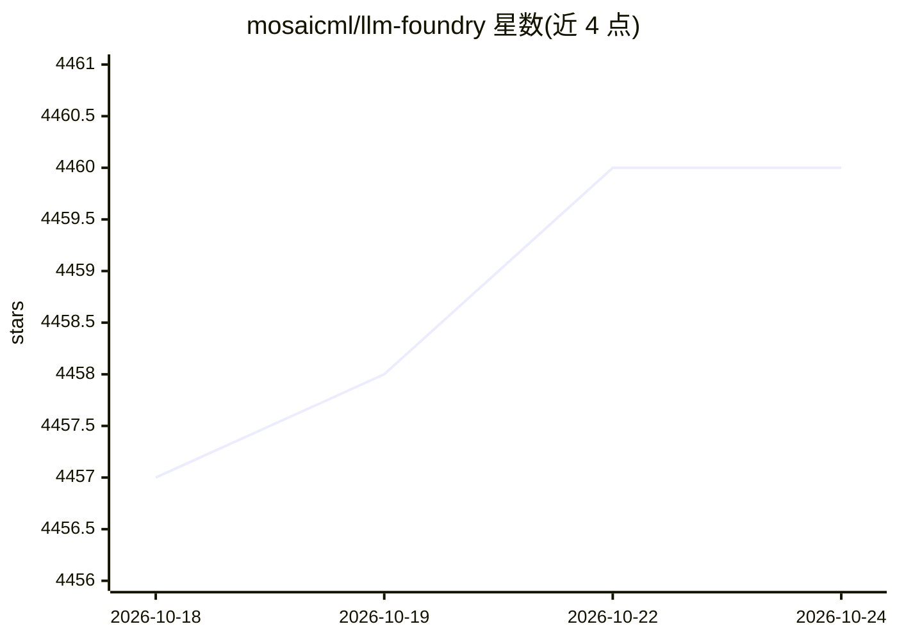

# mosaicml/llm-foundry

⭐ — · [GitHub]() · 组织维护

**面向开发者的 LLM 训练/微调/评测/推理代码库**

Databricks MosaicML 团队维护的 LLM 训练框架，基于 Composer 与 MosaicML 平台，提供模型、数据集、回调与工具源码及脚本：数据转换为 StreamingDataset 格式、训练/微调 HuggingFace 与 MPT 模型（125M-70B）、转换为 HuggingFace 或 ONNX 格式、推理与延迟基准测试、学术与自定义 in-context-learning 评测。配套 DBRX 与 MPT 系列开源模型权重下载链接。推荐使用其预构建 Docker 镜像，在 NVIDIA A100/H100 上测试，AMD 与 Intel Gaudi 为 BETA/实验性支持。提供组件注册机制（registry）以扩展模型、日志器、回调等。

## 筛选速览

| 维度 | 判定 | 备注 |
|---|---|---|
| AI 角色 | `ai-ecosystem` | LLM/agent 周边工具 |
| 许可风险 | `permissive` | — |
| 部署形态 | `library` | 以包/库形式分发 |
| 模型依赖 | — | README 未给出锁定关系 |
| 硬件要求 | — | 无带数字的原话,不猜 |
| 安装摩擦 | `high` | 编译与系统依赖俱全 |
| 成熟度 | `idea` | |

## 能力要点

- 训练/微调 125M-70B 参数的 HuggingFace 与 MPT 模型
- 数据准备、模型格式转换（HF/ONNX）、推理与评测脚本齐全
- 配套 DBRX（MoE，132B 总参/36B 激活）与 MPT 系列开源模型
- registry 机制支持注册自定义模型、日志器与回调

## 适用场景

- 我要从零训练或微调一个开源 LLM
- 我要把训练好的模型转成 HuggingFace/ONNX 格式并做推理
- 我要在学术或自定义任务上评测 LLM 的 in-context learning 表现

## 场景标签

`微调` `模型训练` `模型评测` · 领域:评测与运维

## 证据(README 行号)

> L22: This repository contains code for training, finetuning, evaluating, and deploying LLMs for inference with Composer 
> L26: * `scripts/` - scripts to run LLM workloads
> L28:  * `train/` - train or finetune HuggingFace and MPT models from 125M - 70B parameters

## 星数曲线

2026-10-18 4,457 → 2026-10-24 4,460（+3）

---
*卡片 v1 · prompt 1.4 · 生成 2026-10-20 · 置信度 high · 依据 README sha `f79e66cee9f1` · [字段定义](../../DATASET.md)*
