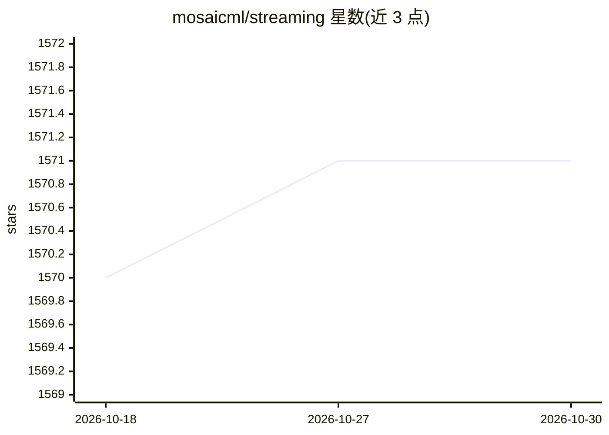

# mosaicml/streaming

⭐ 1,571 · Python · Apache-2.0 · 推送 2026-06-25 · [GitHub](https://github.com/mosaicml/streaming) · [官网](https://streaming.docs.mosaicml.com) · 组织维护

**面向分布式神经网络训练的云存储数据流式读取库**

MosaicML（Databricks）维护的 Python 数据流库：将数据集转换为 MDS/CSV/JSONL 等格式并上传云存储后，以 PyTorch IterableDataset 的替代形式流式读取训练数据，支持 AWS/GCS/Azure/OCI 及任意 S3 兼容对象存储。关键机制包括跨 GPU/节点数的样本顺序确定性、mid-epoch 秒级恢复、随机访问、按比例混合多数据集、cache_limit 磁盘用量控制。数据类型覆盖图像、文本、视频与多模态。以 pip 包提供，附多个常用数据集的转换脚本。

## 筛选速览

| 维度 | 判定 | 备注 |
|---|---|---|
| AI 角色 | `ai-ecosystem` | LLM/agent 周边工具 |
| 许可风险 | `permissive` | Apache-2.0 |
| 部署形态 | `library` | 以包/库形式分发 |
| 模型依赖 | — | README 未给出锁定关系 |
| 硬件要求 | — | 无带数字的原话,不猜 |
| 安装摩擦 | `low` | 无编译、无系统依赖或容器化 |
| 成熟度 | — | 结构信号不足 |

## 能力要点

- 样本顺序不随 GPU/节点数变化，支持跨规模复现与 mid-epoch 快速恢复
- Stream 对象按比例/绝对量无缝混合多个数据集
- 随机访问 dataset[i]，未下载样本会即时触发下载
- cache_limit 参数按 LRU 删除分片以限制磁盘用量

## 适用场景

- 在多节点分布式训练中直接从云存储流式读取大规模数据集
- 混合多个数据集（如 C4 + 代码 + 内部数据）做配比训练
- 把 LAION-400M、COCO、ImageNet 等常用数据集转为 MDS 格式后训练

## 场景标签

 · 领域:深度学习/数据基础设施

## 证据(README 行号)

> L43: We built StreamingDataset to make training on large datasets from cloud storage as fast, cheap, and scalable as pos
> L49: With support for major cloud storage providers (AWS, OCI, GCS, Azure, Databricks, and any S3 compatible object stor
> L60: pip install mosaicml-streaming

## 星数曲线

2026-10-18 1,570 → 2026-10-30 1,571（+1）

---
*卡片 v1 · prompt 1.4 · 生成 2026-10-21 · 置信度 high · 依据 README sha `a7cf72dc47b5` · [字段定义](../../DATASET.md)*
