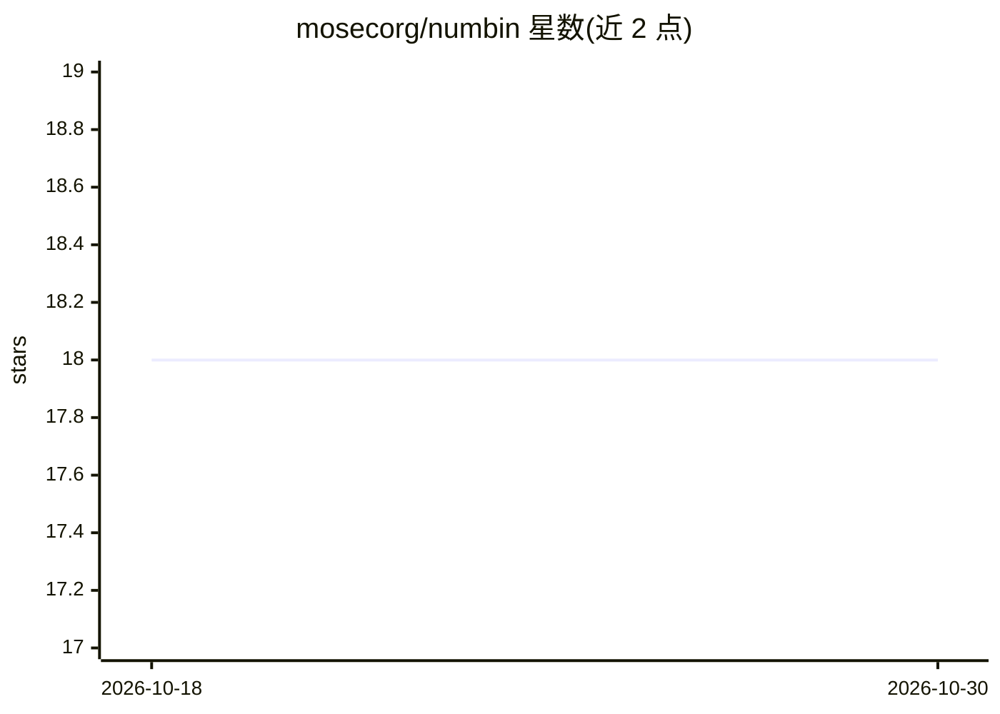

# mosecorg/numbin

⭐ 18 · Python · Apache-2.0 · 推送 2025-11-03 · [GitHub](https://github.com/mosecorg/numbin) · 组织维护

**面向数值数据的二进制序列化格式 Python 库**

NumBin 提供一种用于数值数据的二进制序列化格式，以 Python 库形式分发，通过 pip 安装后 import numbin 即可使用。支持纯 NumPy 数组数据的序列化/反序列化，并通过 numbin.msg_ext 的 NumBinMessage 支持复杂数据结构。仓库内置基准测试脚本 bench.py，README 记录了在 Intel i7-13700K、Python 3.11 环境下与 pickle 等方式的序列化耗时/体积对比数据（pip install .[bench] 可复现）。面向需要传输或存储数值数据的 Python/科学计算开发者。

## 筛选速览

| 维度 | 判定 | 备注 |
|---|---|---|
| AI 角色 | `ai-ecosystem` | LLM/agent 周边工具 |
| 许可风险 | `permissive` | Apache-2.0 |
| 部署形态 | `library` | 以包/库形式分发 |
| 模型依赖 | — | README 未给出锁定关系 |
| 硬件要求 | — | 无带数字的原话,不猜 |
| 安装摩擦 | `low` | 无编译、无系统依赖或容器化 |
| 成熟度 | — | 结构信号不足 |

## 能力要点

- 提供数值数据二进制序列化格式的 Python 实现
- 支持纯 NumPy 数组与含复杂数据的结构（NumBinMessage）
- 内置 bench.py 基准测试脚本，README 附与 pickle 等的对比数据

## 适用场景

- 序列化 NumPy 数组用于网络传输或存储
- 对比不同序列化方式的耗时与体积后做选型
- 在科学计算/机器学习流水线中交换数值数据

## 场景标签

 · 领域:科学计算/数据序列化

## 证据(README 行号)

> L16: An efficient binary serialization format for numerical data.
> L29: import numbin as nb

## 星数曲线

2026-10-18 18 → 2026-10-30 18（+0）

---
*卡片 v1 · prompt 1.4 · 生成 2026-10-29 · 置信度 mid · 依据 README sha `4999320a4321` · [字段定义](../../DATASET.md)*
