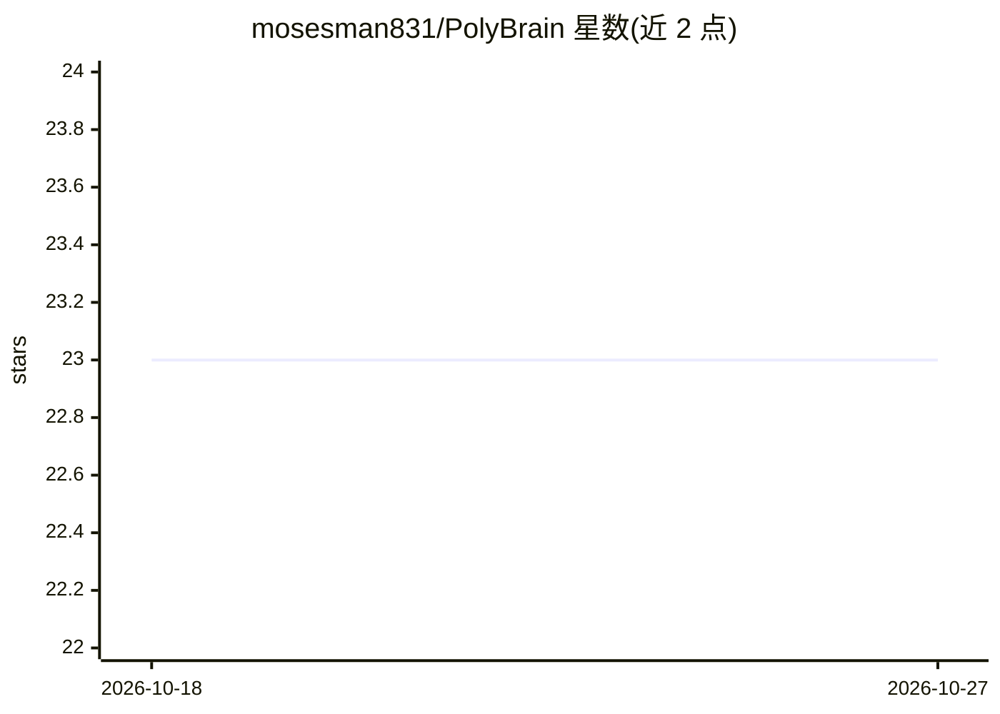

# mosesman831/PolyBrain

⭐ 23 · Python · GPL-3.0 · 推送 2026-07-09 · [GitHub](https://github.com/mosesman831/PolyBrain) · 个人维护

**Hermes Agent 的多模型编排技能：并行子代理与引用验证**

面向 Hermes Agent 的多代理多模型编排层（Python 技能包）：将单一目标分解为 JSON 任务计划，按角色（Orchestrator/Researcher/Builder/Synthesizer/Verifier）并行执行，最后合并产出。每个角色可在 config.yaml 中独立指定不同模型/提供商。强制引用（无出处的声明被丢弃），验证器逐条核对声明与来源并给出 PASS/FAIL，运行产物按时间戳落盘。安装方式为 git clone 后放入 Hermes skills 目录，或直接运行 orchestrate.py 脚本。受 GPLv3 许可。

## 筛选速览

| 维度 | 判定 | 备注 |
|---|---|---|
| AI 角色 | `ai-ecosystem` | LLM/agent 周边工具 |
| 许可风险 | `viral` | GPL-3.0 |
| 部署形态 | `None` |  |
| 模型依赖 | — | README 未给出锁定关系 |
| 硬件要求 | — | 无带数字的原话,不猜 |
| 安装摩擦 | `low` | 无编译、无系统依赖或容器化 |
| 成熟度 | — | 结构信号不足 |

## 能力要点

- 任务分解→并行子代理→综合→逐条验证的工作流
- 角色级多模型路由（不同角色可用不同 LLM/提供商）
- 引用强制：无出处的声明被丢弃
- 验证器逐条核对声明与来源，输出 PASS/FAIL

## 适用场景

- 让 Hermes Agent 并行调度多个模型完成研究与构建任务
- 需要带来源引用与逐条验证的调研报告
- 为不同角色（研究/综合/验证）分配不同模型以组合多模型流水线

## 场景标签

`多智能体` `Agent 框架` · 领域:Agent 开发

## 证据(README 行号)

> L31:  A multi-agent, multi-model orchestration layer for Hermes Agent.
> L40: PolyBrain turns a single objective into a coordinated multi-agent workflow: it decomposes the task, routes work to 
> L54: - **Multi-model, not just multi-agent** - different roles can use different LLMs, not just different agents on the 

## 星数曲线

2026-10-18 23 → 2026-10-27 23（+0）

---
*卡片 v1 · prompt 1.4 · 生成 2026-10-27 · 置信度 high · 依据 README sha `93023857a733` · [字段定义](../../DATASET.md)*
