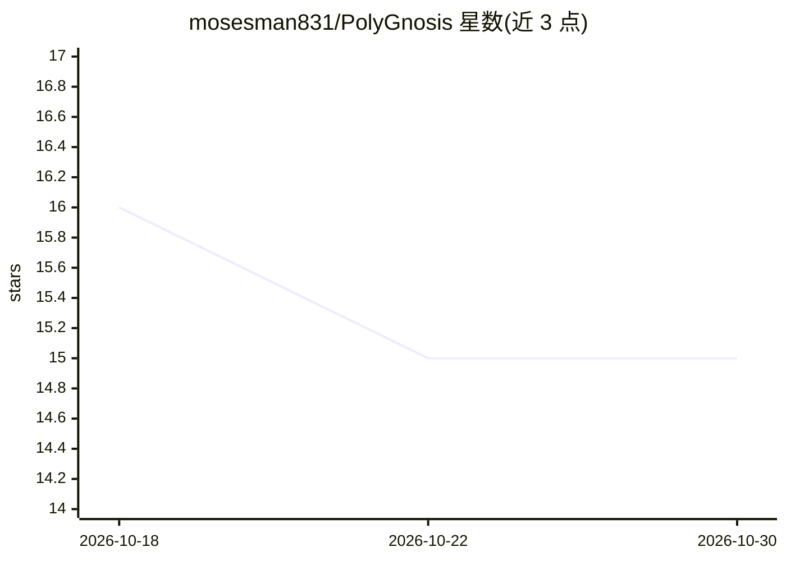

# mosesman831/PolyGnosis

⭐ 15 · Python · GPL-3.0 · 推送 2026-07-16 · [GitHub](https://github.com/mosesman831/PolyGnosis) · 个人维护

**Hermes Agent 的多模型对抗共识协议：多模型独立解题+批判评分**

面向 Hermes Agent 的多模型共识编排技能：将复杂问题交给 3 个以上不同家族的前端模型，由编排器动态分配专家角色（如安全审计、后端架构）并按角色限制工具权限，模型并行独立求解；专职批判模型审查每个方案，LLM 按 5 维度打分（0-10）后由 RRF 与 Borda Count 算法确定性排序，合成器融合最优方案，质量门检查合成是否退化。支持一致即提前结束以省成本、严重缺陷写入 Reflexion 缓冲注入后续提示。通过 git clone 安装为 Hermes skill，配置 config.yaml 指定各角色模型，已知问题包括特定模型子进程挂起与批判 JSON 解析失败时的降级处理。

## 筛选速览

| 维度 | 判定 | 备注 |
|---|---|---|
| AI 角色 | `ai-ecosystem` | LLM/agent 周边工具 |
| 许可风险 | `viral` | GPL-3.0 |
| 部署形态 | `None` |  |
| 模型依赖 | — | README 未给出锁定关系 |
| 硬件要求 | — | 无带数字的原话,不猜 |
| 安装摩擦 | `low` | 无编译、无系统依赖或容器化 |
| 成熟度 | — | 结构信号不足 |

## 能力要点

- 3+ 个不同模型家族并行独立求解，角色决定工具权限
- 专职 critic 模型对抗审查每个方案
- RRF + Borda Count 确定性共识排序（5 维度 0-10 评分）
- Constitutional Quality Gate 检测合成退化，Reflexion 缓冲持续注入历史缺陷

## 适用场景

- 在 Hermes Agent 中对高风险任务做多模型交叉验证，降低单模型幻觉风险
- 需要可解释共识过程：获取评分、批判报告与 Meta-review
- 通过 Early Resolution 在模型一致时跳过批判与评分以降低成本

## 场景标签

`多智能体` · 领域:Agent 开发

## 证据(README 行号)

> L21:  Adversarial multi-model consensus protocol for Hermes Agent.
> L89: |**Parallel Solve**|3+ distinct model families solve independently from specialized personas - all at once via Thre

## 星数曲线

2026-10-18 16 → 2026-10-30 15（-1）

---
*卡片 v1 · prompt 1.4 · 生成 2026-10-30 · 置信度 high · 依据 README sha `59a6d3e8f713` · [字段定义](../../DATASET.md)*
