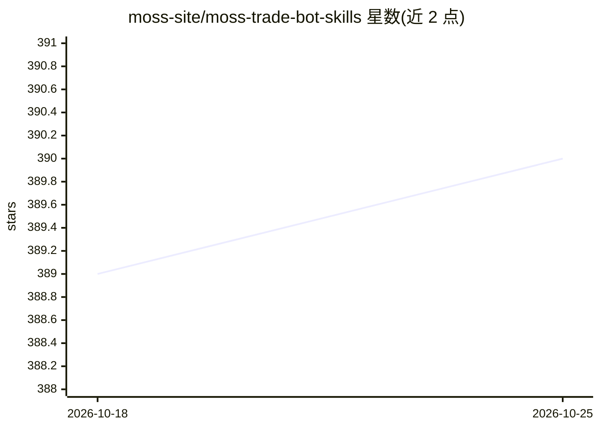

# moss-site/moss-trade-bot-skills

⭐ 390 · Python · MIT-0 · 推送 2026-10-20 · [GitHub](https://github.com/moss-site/moss-trade-bot-skills) · [官网](https://moss.site/) · 组织维护

**用自然语言生成并进化加密货币交易 agent 的策略工厂**

面向加密货币量化交易的 AI agent 技能仓库：用户用自然语言描述交易风格，系统自动推断方向、杠杆、风险参数与技术指标，生成本地可运行的交易策略。内置全仓保证金回测引擎（Sharpe、最大回撤、胜率等指标）与嵌入式进化机制——AI 按分段回测结果应用 7 条反思原则微调战术参数（±30% 以内），性格参数锁定。附带杠杆上限、强制止损与实盘确认门安全机制。本地优先，可选绑定 Moss 平台做验证与模拟实盘；数据集首次运行时从 GitHub Release 自动下载并校验。README 声明仅用于研究与教育目的。

## 筛选速览

| 维度 | 判定 | 备注 |
|---|---|---|
| AI 角色 | `ai-native` | 本体是模型或模型工具 |
| 许可风险 | `permissive` | MIT-0 |
| 部署形态 | `library` | 以包/库形式分发 |
| 模型依赖 | — | README 未给出锁定关系 |
| 硬件要求 | — | 无带数字的原话,不猜 |
| 安装摩擦 | `low` | 无编译、无系统依赖或容器化 |
| 成熟度 | — | 结构信号不足 |

## 能力要点

- 自然语言描述自动推断策略参数（方向/杠杆/风险/指标）
- 本地回测引擎：全仓保证金模拟、状态检测、Sharpe/最大回撤/胜率
- 嵌入式进化循环：7 条反思原则，战术参数微调 ±30%，性格参数锁定
- 安全机制：杠杆上限、高杠杆强制宽止损、实盘确认门

## 适用场景

- 我想用一句话描述交易风格就得到一个可回测的加密货币交易 agent
- 我想让 agent 根据历史回测结果自动反思并迭代策略参数
- 我想在真实 Hyperliquid 市场条件（费率/滑点/资金费率）下做回测

## 场景标签

`金融量化` · 领域:学习与行业

## 证据(README 行号)

> L5: > 🎉 **Moss** is an intelligent quantitative trading bot factory and strategy tuner. By simply describing your tradin
> L33: Moss transforms natural language descriptions into fully functional cryptocurrency trading strategies. It bridges t
> L65: Describe your trading style (e.g., "Trend following, conservative leverage, breakout strategy"), and the AI automat

## 星数曲线

2026-10-18 389 → 2026-10-25 390（+1）

---
*卡片 v1 · prompt 1.4 · 生成 2026-10-21 · 置信度 mid · 依据 README sha `605ff4189b98` · [字段定义](../../DATASET.md)*
