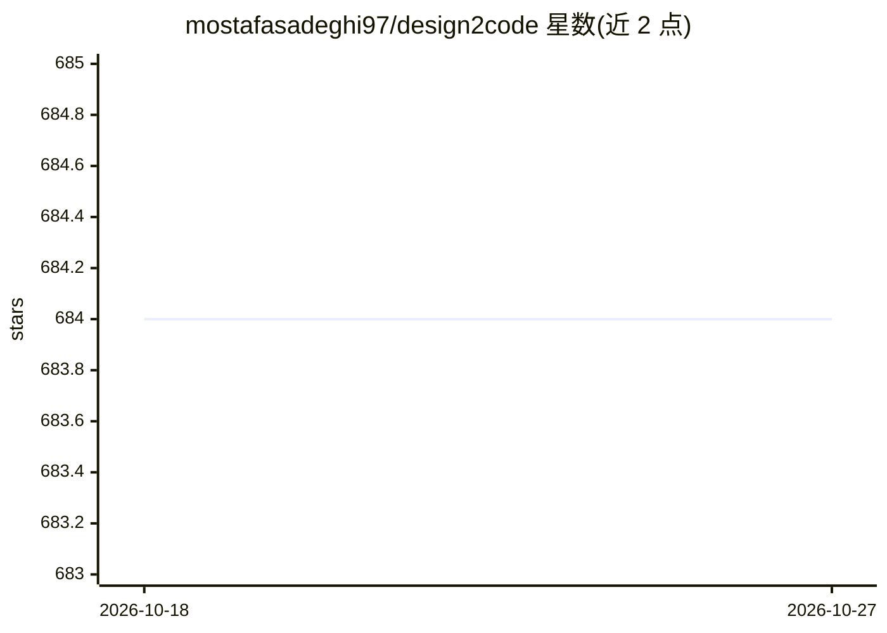

# mostafasadeghi97/design2code

⭐ 684 · TypeScript · MIT · 推送 2026-07-01 · [GitHub](https://github.com/mostafasadeghi97/design2code) · 个人维护

**把设计截图/线框/Figma 转成 HTML/CSS/JS 代码的 Web 应用**

基于 Next.js 构建的开源 Web 应用：用户上传设计图（草图、线框图、Figma、XD 等格式截图），应用调用视觉模型自动生成对应的响应式 HTML/CSS/JS 代码。提供 Vercel 一键部署自有实例，另有托管在线演示与 OpenAI GPT 版本入口；使用 Vercel hobby 计划时需调整 API 路由的 maxDuration 配置。README 未列出本地安装命令与具体模型调用细节。面向需要设计转代码的前端开发者和设计者。

## 筛选速览

| 维度 | 判定 | 备注 |
|---|---|---|
| AI 角色 | `ai-native` | 本体是模型或模型工具 |
| 许可风险 | `permissive` | MIT |
| 部署形态 | `None` |  |
| 模型依赖 | — | README 未给出锁定关系 |
| 硬件要求 | — | 无带数字的原话,不猜 |
| 安装摩擦 | `low` | 无编译、无系统依赖或容器化 |
| 成熟度 | — | 结构信号不足 |

## 能力要点

- 设计图上传后自动生成 HTML/CSS/JS 代码
- 支持草图、线框图、Figma、XD 等设计格式
- Vercel 一键部署，另有托管演示与 GPT 版本

## 适用场景

- 把手绘草图或线框图快速转成可用前端代码
- 从 Figma/XD 设计稿生成响应式页面代码
- 通过托管演示直接试用设计转代码效果

## 场景标签

`代码生成` · 领域:编码与开发

## 证据(README 行号)

> L7: Design2Code is an open-source project that converts various web design formats, including sketches, wireframes, Figm
> L19: ## OpenAI GPT

## 星数曲线

2026-10-18 684 → 2026-10-27 684（+0）

---
*卡片 v1 · prompt 1.4 · 生成 2026-10-21 · 置信度 mid · 依据 README sha `2850b51f250d` · [字段定义](../../DATASET.md)*
