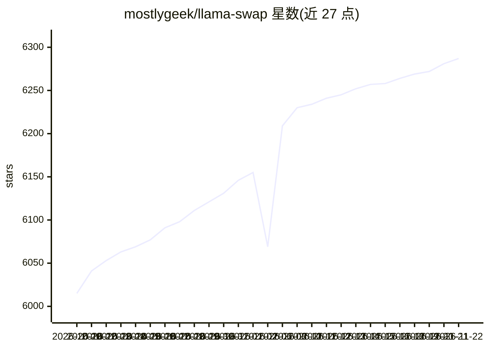

# mostlygeek/llama-swap

⭐ 6,287 · Go · MIT · 推送 2026-11-20 · [GitHub](https://github.com/mostlygeek/llama-swap) · [官网](https://llama-swap.ai) · 个人维护

**本地 AI 服务器间的模型按需热切换代理**

用 Go 编写的本地推理代理：用户在配置文件中声明各模型对应的启动命令，llama-swap 收到请求时按需启动对应服务器并自动卸载其他模型，实现单机多模型切换。代理 OpenAI、Anthropic 及 llama.cpp/stable-diffusion.cpp/audio.cpp/ComfyUI 等服务器的 API 端点，附带 Web UI（playground、token 指标、日志流）、API key、TTL 自动卸载、profiles 路由与 Prometheus 指标。单二进制零外部依赖，面向在本地机器运行多个生成式模型的用户。

## 筛选速览

| 维度 | 判定 | 备注 |
|---|---|---|
| AI 角色 | `ai-ecosystem` | LLM/agent 周边工具 |
| 许可风险 | `permissive` | MIT |
| 部署形态 | `desktop` | 安装包/桌面程序 |
| 模型依赖 | local-ok | 支持本地模型 |
| 硬件要求 | — | 无带数字的原话,不猜 |
| 安装摩擦 | `low` | 无编译、无系统依赖或容器化 |
| 成熟度 | — | 结构信号不足 |

## 能力要点

- 按需启动/热切换多个本地 AI 服务器，支持 ttl 自动卸载与并发运行（matrix DSL）
- 代理 OpenAI、Anthropic、llama-server、SDAPI、audio.cpp 等多类 API 端点
- 单二进制零依赖，提供 Web UI、API key、日志流与 Prometheus 指标
- 提供 Docker/Podman、Homebrew、MacPorts、WinGet、二进制与源码多种安装方式

## 适用场景

- 单张显卡上按需切换使用多个本地大模型
- 用统一的 OpenAI/Anthropic API 接口访问多种本地推理服务器
- 通过 Web UI 查看模型运行状态、token 指标与实时日志

## 场景标签

`模型网关` · 领域:Agent 开发

## 证据(README 行号)

> L8: Run multiple generative AI models on your machine and hot-swap between them on demand. llama-swap works with any Ope
> L19: - ✅ On-demand model switching for many local AI servers (llama.cpp + forks, vllm, stable-diffusion.cpp, audio.cpp, 
> L50: - ✅ llama-swap API

## 星数曲线

2026-10-20 6,015 → 2026-11-22 6,287（+272）

---
*卡片 v1 · prompt 1.4 · 生成 2026-11-22 · 置信度 high · 依据 README sha `4c2fc7e093fb` · [字段定义](../../DATASET.md)*
