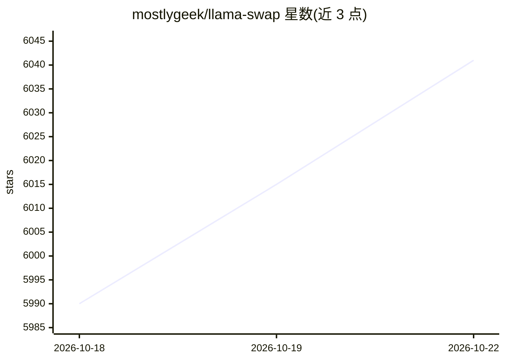

# mostlygeek/llama-swap

⭐ 6,053 · Go · MIT · 推送 2026-10-21 · [GitHub](https://github.com/mostlygeek/llama-swap) · 个人维护

**本地多模型热切换代理：统一 OpenAI/Anthropic API 按需换模型**

用 Go 编写的单一二进制代理，置于客户端与本地推理服务器（llama.cpp 及其分支、vllm、ComfyUI、stable-diffusion.cpp 等）之间：从请求中提取 model 字段，自动启动/替换对应的上游服务器，实现单配置多模型按需热切换；支持 OpenAI 与 Anthropic 多类端点、API Key 限制、ttl 自动卸载、matrix 并发模型 DSL、Prometheus 指标与 Web UI。面向本地 AI 工作流的开发者，提供 Docker、Homebrew、WinGet 及多平台预编译二进制。

## 筛选速览

| 维度 | 判定 | 备注 |
|---|---|---|
| AI 角色 | `ai-ecosystem` | LLM/agent 周边工具 |
| 许可风险 | `permissive` | MIT |
| 部署形态 | `desktop` | 安装包/桌面程序 |
| 模型依赖 | local-ok | 支持本地模型 |
| 硬件要求 | — | 无带数字的原话,不猜 |
| 安装摩擦 | `low` | 无编译、无系统依赖或容器化 |
| 成熟度 | — | 结构信号不足 |

## 能力要点

- 按请求中的 model 值自动启动并替换上游推理服务器
- 支持 llama.cpp 及分支、vllm、ComfyUI、stable-diffusion.cpp 等本地服务器
- OpenAI 与 Anthropic 兼容端点代理（chat/completions、messages、embeddings、图像、音频等）
- ttl 自动卸载、matrix 并发模型 DSL、Prometheus 指标、Web UI 与日志流

## 适用场景

- 单机显存有限时在多个本地模型间按需切换
- 用统一 OpenAI/Anthropic 兼容地址访问不同的本地推理后端
- 通过 Web UI 与 playground 测试、加载卸载本地模型
- 本地文档助手通过 MCP 端点查询 llama-swap 配置

## 场景标签

`推理引擎` `模型网关` · 领域:Agent 开发

## 证据(README 行号)

> L8: Run multiple generative AI models on your machine and hot-swap between them on demand. llama-swap works with any Ope
> L315: When a request is made to an OpenAI compatible endpoint, llama-swap will extract the `model` value and load the ap

## 星数曲线

2026-10-18 5,990 → 2026-10-22 6,041（+51）

---
*卡片 v1 · prompt 1.4 · 生成 2026-10-20 · 置信度 high · 依据 README sha `32e8188aa7f7` · [字段定义](../../DATASET.md)*
