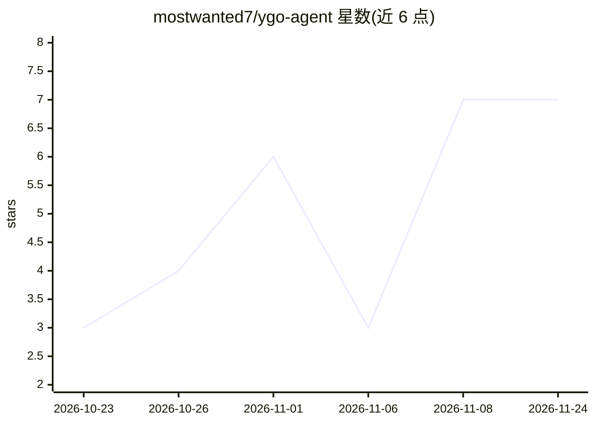

# mostwanted7/ygo-agent

⭐ 7 · Python · AGPL-3.0 · 推送 2026-11-18 · [GitHub](https://github.com/mostwanted7/ygo-agent) · [官网](www.rebel7.no) · 个人维护

**连接 LLM 到 EDOPro 的游戏王 AI 对手、教练与测试环境**

无头对局宿主，将语言模型接入 EDOPro 游戏引擎：引擎生成可行决策，模型接收允许视野内的牌面与选项并返回选择加解释，代理校验后回传引擎；浏览器面板实时展示棋盘、每步决策与模型计划。提供 Play、Self-play、Coach、Teach、Benchmark 等七种模式，含 7 套牌组配置、牌谱训练（生成 playbook 而非改模型权重）与可复现基准评测。限制：仅支持 pre-Pendulum（MR2 时代）机制，默认 Master Rule 3。

## 筛选速览

| 维度 | 判定 | 备注 |
|---|---|---|
| AI 角色 | `ai-native` | 本体是模型或模型工具 |
| 许可风险 | `viral` | AGPL-3.0 |
| 部署形态 | `library` | 以包/库形式分发 |
| 模型依赖 | local-ok | 支持本地模型 |
| 硬件要求 | — | 无带数字的原话,不猜 |
| 安装摩擦 | `low` | 无编译、无系统依赖或容器化 |
| 成熟度 | `idea` | |

## 能力要点

- LLM 通过引擎校验回传合法决策，并给出解释与计划
- 可插拔模型后端：Claude Code 默认，支持 Anthropic API 与 OpenAI 兼容服务器
- Coach 模式：玩家自行走子，代理实时建议与复盘
- 固定种子的自对弈批量测试、决策回放与回归用例

## 适用场景

- 在 EDOPro 中与 AI 对手打牌并查看它的决策理由
- 打牌时获得 AI 教练的实时建议与赛后复盘
- 用固定种子批量跑 AI vs AI 对局，比较不同模型表现

## 场景标签

`模型评测` · 领域:评测与运维

## 证据(README 行号)

> L5: **An LLM-powered Yu-Gi-Oh! opponent, coach and testing environment for EDOPro.**
> L14: ygo-agent connects a language model to EDOPro's game engine; it is not a separately trained model. Claude Code is
> L76: 1. **EDOPro runs the duel.** The engine generates the available decisions and resolves card effects.

## 星数曲线

2026-10-23 3 → 2026-11-24 7（+4）

---
*卡片 v1 · prompt 1.4 · 生成 2026-11-20 · 置信度 mid · 依据 README sha `85469105d9a7` · [字段定义](../../DATASET.md)*
