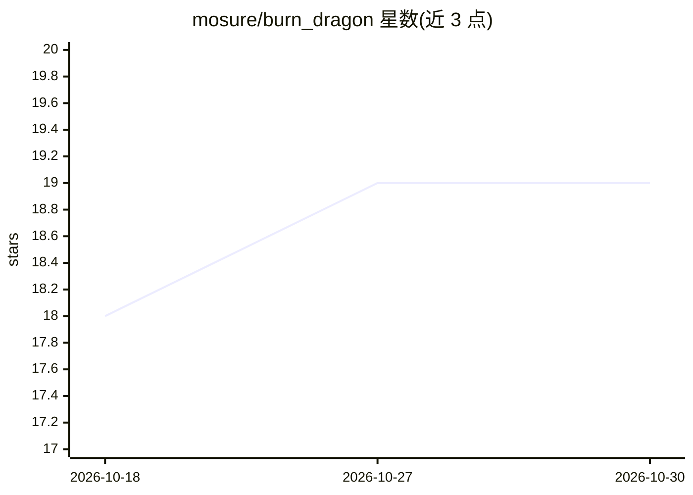

# mosure/burn_dragon

⭐ 19 · Rust · Apache-2.0 · 推送 2026-04-12 · [GitHub](https://github.com/mosure/burn_dragon) · [官网](https://mosure.github.io/burn_dragon/) · 个人维护

**Rust 版 dragon hatchling 模型的推理与训练实现**

基于 burn 深度学习框架实现的 dragon hatchling 模型（transformer/state-space 混合类小型语言模型，受 NanoGPT 影响），提供缓存推理、训练基准测试报告、pope 位置编码与 wasm 部署；多项功能（专家路由、多模态、情景记忆等）仍在待办清单。通过 cargo 命令运行训练（默认 CUDA 后端）与流式推理，兼容 burn 0.18/0.19，数据集配置内置预设并含 Hugging Face 示例。

## 筛选速览

| 维度 | 判定 | 备注 |
|---|---|---|
| AI 角色 | `ai-native` | 本体是模型或模型工具 |
| 许可风险 | `permissive` | Apache-2.0 |
| 部署形态 | `library` | 以包/库形式分发 |
| 模型依赖 | — | README 未给出锁定关系 |
| 硬件要求 | — | 无带数字的原话,不猜 |
| 安装摩擦 | `medium` | 含编译或系统依赖之一 |
| 成熟度 | `idea` | |

## 能力要点

- 缓存推理与流式 token 生成
- 训练基准测试（wgpu 与 CUDA）与报告
- wasm 部署支持
- pope 位置编码实现

## 适用场景

- 用 Rust burn 框架训练小型语言模型
- 在 CUDA 或 wgpu 后端跑推理与基准测试
- 复现 dragon hatchling 模型实验

## 场景标签

`模型训练` `推理引擎` · 领域:训练与推理

## 证据(README 行号)

> L7: burn inference and training of dragon hatchling model
> L15: - [x] training benchmarks and reporting

## 星数曲线

2026-10-18 18 → 2026-10-30 19（+1）

---
*卡片 v1 · prompt 1.4 · 生成 2026-10-28 · 置信度 mid · 依据 README sha `f4912c5bb0ba` · [字段定义](../../DATASET.md)*
