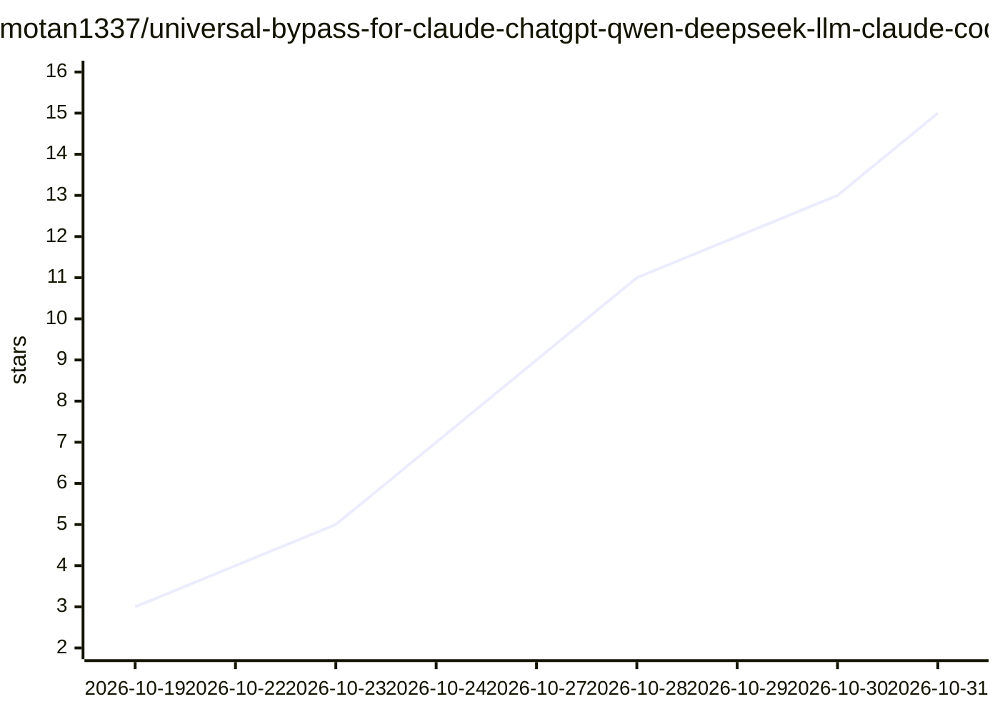

# motan1337/universal-bypass-for-claude-chatgpt-qwen-deepseek-llm-claude-code-codex

⭐ 15 · MIT · 推送 2026-10-28 · [GitHub](https://github.com/motan1337/universal-bypass-for-claude-chatgpt-qwen-deepseek-llm-claude-code-codex) · 个人维护

**针对多家前沿 LLM 的人工编写越狱提示词集合**

由个人维护者手工编写的 LLM 越狱（jailbreak）提示词仓库，目标模型覆盖 Claude（Opus 4.7 及以下）、GPT-6 系列（Astra/SoL 等）、DeepSeek V4 系列、Qwen 3.8 系列等。README 说明各提示文件的适用模型与使用条件，如关闭思考模式、调整 Codex effort 等级、将提示注入用户偏好/自定义指令等；条目包括 GRIGORE BAROS 主提示、4.txt（标注为他人所作，面向角色扮演/写作）、deepseek/deepseek-pro、gpt-claude-test、1.md 等。仓库仅提供提示文本文件，无安装或运行流程。

## 筛选速览

| 维度 | 判定 | 备注 |
|---|---|---|
| AI 角色 | `ai-knowledge` | 知识聚合/清单类 |
| 许可风险 | `permissive` | MIT |
| 部署形态 | `None` |  |
| 模型依赖 | — | README 未给出锁定关系 |
| 硬件要求 | — | 无带数字的原话,不猜 |
| 安装摩擦 | `low` | 无编译、无系统依赖或容器化 |
| 成熟度 | — | 结构信号不足 |

## 能力要点

- 覆盖 Claude/GPT/DeepSeek/Qwen 多系列模型版本的目标提示文件
- README 记录各模型的使用条件差异（思考模式开关、effort 等级、自定义指令注入）
- 条目按目标模型分类（通用/旧款/Pro 版本/测试中）

## 适用场景

- 查找针对特定模型版本的越狱提示文件
- 了解各模型在思考模式与 effort 设置下的拒绝行为差异
- 获取面向角色扮演与写作场景的提示文件（4.txt）

## 场景标签

`精选清单` · 领域:学习与行业

## 证据(README 行号)

> L1: # bypass-for-claude-chatgpt-qwen-deepseek-llm-claude-code-codex
> L2: Carefully human hand written llm jailbreaks for the latest models that are available on the market. GPT-6 Astra, GPT

## 星数曲线

2026-10-19 3 → 2026-10-31 15（+12）

---
*卡片 v1 · prompt 1.4 · 生成 2026-10-30 · 置信度 high · 依据 README sha `d32d599e1cf3` · [字段定义](../../DATASET.md)*
