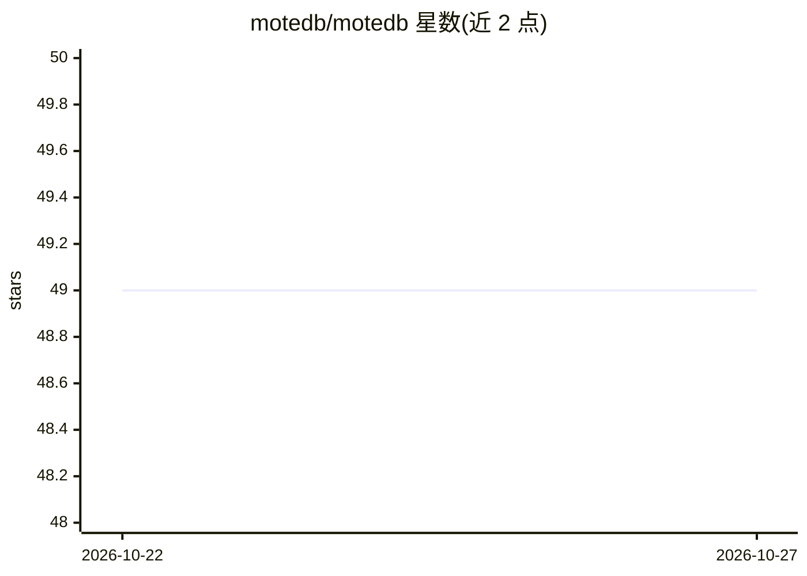

# motedb/motedb

⭐ — · [GitHub]() · 组织维护 · 中文 README

**面向具身智能与机器人的 AI 原生嵌入式多模态数据库**

用 Rust 编写的单库嵌入式列式 SQL 引擎，在同一个引擎内提供向量检索（DiskANN）、全文检索（BM25 FTS）、空间索引（i-Octree 3D）、时间戳索引与 BLOB 存储，支持 ACID 事务与 MVCC 快照隔离。面向具身智能/机器人场景，提供 ASOF JOIN 帧对齐、Episode 轨迹表、MCAP 机器人录制导入、LeRobot v3 数据集导出与 Parquet 互操作。提供 Rust/Python/Node.js/Go 多语言绑定，无守护进程直接嵌入。状态为 pre-1.0，SQL 表面与多语言 FFI 仍在演进。

## 筛选速览

| 维度 | 判定 | 备注 |
|---|---|---|
| AI 角色 | `ai-ecosystem` | LLM/agent 周边工具 |
| 许可风险 | `permissive` | — |
| 部署形态 | `library` | 以包/库形式分发 |
| 模型依赖 | — | README 未给出锁定关系 |
| 硬件要求 | — | 无带数字的原话,不猜 |
| 安装摩擦 | `low` | 无编译、无系统依赖或容器化 |
| 成熟度 | `idea` | |

## 能力要点

- 单引擎多模态：向量 DiskANN + FTS BM25 + 空间 i-Octree + B-tree，含 RRF 混合检索
- 面向机器人：ASOF JOIN 帧对齐、Episode 轨迹表、MCAP 导入、LeRobot v3 导出
- 嵌入式低资源：无守护进程，222 B/行内存、zstd 压缩、edge preset 配置
- ACID：WAL 崩溃恢复、MVCC 快照隔离、数据集快照 pinned segment

## 适用场景

- 机器人在边缘设备上本地存储与查询多模态感知数据
- 检索实验数据集：按向量、全文、时间窗口混合查询机器人录制
- 把 MCAP 录制导入 SQL 后做帧-状态对齐与轨迹分析
- 为 RAG 应用提供嵌入式向量+全文混合检索存储

## 场景标签

`向量数据库` · 领域:知识与检索

## 证据(README 行号)

> L3: **AI-native embedded multimodal database for embodied intelligence.**
> L4: Columnar storage engine with ACID transactions, vector search, full-text search, and spatial indexing — in a single 
> L190: |Vector|DiskANN (Vamana graph)|`ORDER BY col <-> query LIMIT k`|
> L196: - **Low memory**: 222 B/row (vs SQLite's 335 B — 34% less); 查询期 RSS 增量 ≈0

## 星数曲线

2026-10-22 49 → 2026-10-27 49（+0）

---
*卡片 v1 · prompt 1.4 · 生成 2026-10-25 · 置信度 high · 依据 README sha `3d57a189c392` · [字段定义](../../DATASET.md)*
