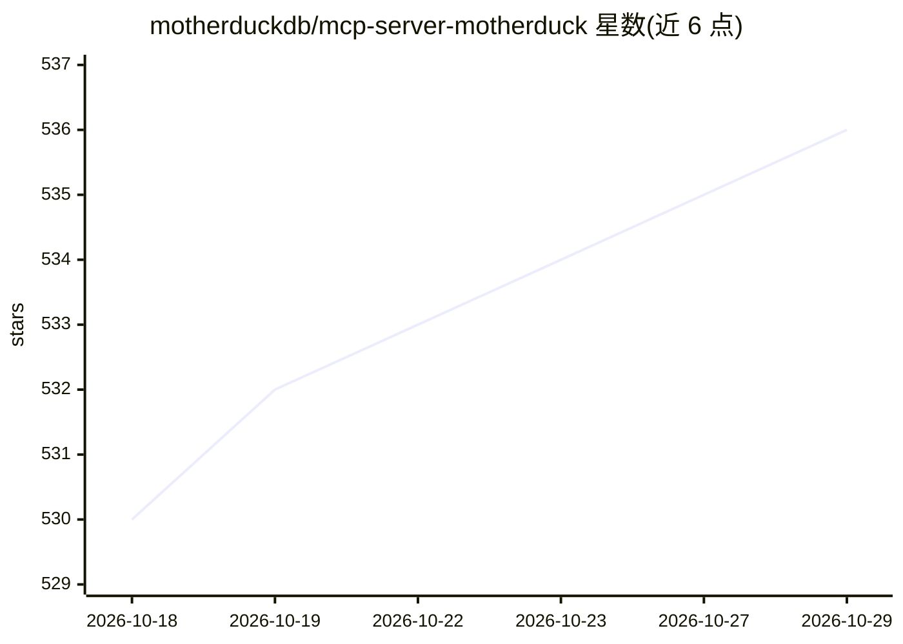

# motherduckdb/mcp-server-motherduck

⭐ 536 · Python · MIT · 推送 2026-10-26 · [GitHub](https://github.com/motherduckdb/mcp-server-motherduck) · 组织维护

**面向 AI 助手的 DuckDB/MotherDuck 本地 MCP 服务器**

由 MotherDuck 团队维护的本地 MCP server，把 DuckDB 的分析 SQL 引擎接入 AI 助手与 IDE：可连接本地 DuckDB 文件、内存库、S3 上的数据库及 MotherDuck，支持读写查询、浏览数据库目录及运行时切换数据库连接。提供 execute_query、list_databases、list_tables 等工具，结果默认限 1024 行/50000 字符。通过 uvx 运行，配置接入 Claude Desktop、Claude Code、Codex CLI、Gemini CLI、Cursor、VS Code 等客户端，支持 Docker 以 HTTP 传输部署。

## 筛选速览

| 维度 | 判定 | 备注 |
|---|---|---|
| AI 角色 | `ai-ecosystem` | LLM/agent 周边工具 |
| 许可风险 | `permissive` | MIT |
| 部署形态 | `self-host` | docker 或自建部署 |
| 模型依赖 | — | README 未给出锁定关系 |
| 硬件要求 | — | 无带数字的原话,不猜 |
| 安装摩擦 | `low` | 无编译、无系统依赖或容器化 |
| 成熟度 | — | 结构信号不足 |

## 能力要点

- 连接本地 DuckDB 文件、内存库、S3 数据库与 MotherDuck，支持读写查询
- 运行时切换数据库连接（需 --allow-switch-databases）
- 结果默认限 1024 行/50000 字符，可经 --max-rows/--max-chars 配置
- 提供 Docker 部署（Streamable HTTP，端口 8000）与 SaaS 模式、--init-sql 等安全选项

## 适用场景

- 让 Claude/Cursor 等 IDE 助手直接对 DuckDB 数据做 SQL 分析
- 在 AI 客户端中浏览和查询 MotherDuck 云端数仓
- 本地自托管方式将 SQL 分析能力接入任意 MCP 兼容客户端

## 场景标签

`数据分析` · 领域:效率与自动化

## 证据(README 行号)

> L5:  SQL analytics and data engineering for AI Assistants and IDEs.
> L7: Connect AI assistants to your data using DuckDB's powerful analytical SQL engine. Supports connecting to local DuckD

## 星数曲线

2026-10-18 530 → 2026-10-29 536（+6）

---
*卡片 v1 · prompt 1.4 · 生成 2026-10-21 · 置信度 high · 依据 README sha `355b60028c82` · [字段定义](../../DATASET.md)*
