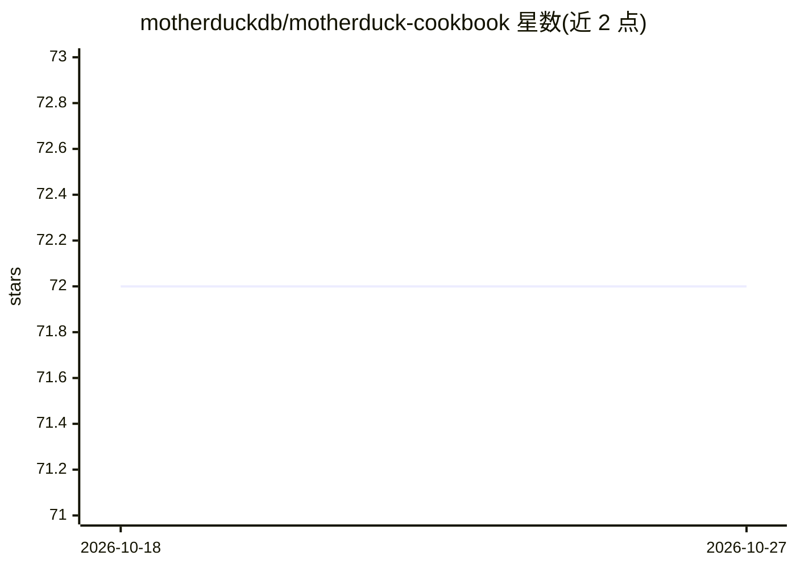

# motherduckdb/motherduck-cookbook

⭐ 72 · Python · Apache-2.0 · 推送 2026-10-26 · [GitHub](https://github.com/motherduckdb/motherduck-cookbook) · [官网](http://motherduck.com/docs/cookbook) · 组织维护

**MotherDuck 官方示例项目集：dbt/接入/边缘集成等可复用代码模板**

MotherDuck 维护的官方 cookbook 仓库，收录自包含的示例工程：dbt 与 SQLMesh 转换项目、dlt/Python 数据接入、Cloudflare Workers/Vercel/Next.js 边缘应用、Grafana/Datadog 可观测性集成，以及 flight-plans/ 目录下的单文件 Flight 模板。每个示例带 YAML front matter（九个键）与结构化 README，同一源码同时供给 GitHub、文档站与 MotherDuck MCP server。通过 get-starter 脚本可拉取单个示例，构建校验用 uv 运行 scripts/build-catalog.py，CI 发布 catalog.json。多数示例需 MotherDuck 账号与 token。

## 筛选速览

| 维度 | 判定 | 备注 |
|---|---|---|
| AI 角色 | `ai-knowledge` | 知识聚合/清单类 |
| 许可风险 | `permissive` | Apache-2.0 |
| 部署形态 | `None` |  |
| 模型依赖 | — | README 未给出锁定关系 |
| 硬件要求 | — | 无带数字的原话,不猜 |
| 安装摩擦 | `low` | 无编译、无系统依赖或容器化 |
| 成熟度 | — | 结构信号不足 |

## 能力要点

- 示例按 dbt 转换/数据接入/边缘应用/集成 UI/Flight 模板分类组织
- 每个示例 README 以 agent skill 风格编写，含 front matter、可调参数表与运行命令
- get-starter 脚本按需拉取单个示例（git sparse checkout）
- 同一源码供给 GitHub、文档站与 MotherDuck MCP server 三个出口

## 适用场景

- 我需要参考现成代码在 MotherDuck 上搭 dbt 数据管道
- 我要把数据从 S3/PostgreSQL/API 接入 MotherDuck
- 我需要监控和可视化 MotherDuck 的查询与存储指标

## 场景标签

`教程课程` · 领域:学习与行业

## 证据(README 行号)

> L5: A cookbook of opinionated, ready-to-use examples for building with MotherDuck.
> L13: The same source feeds several surfaces from one place: GitHub, the

## 星数曲线

2026-10-18 72 → 2026-10-27 72（+0）

---
*卡片 v1 · prompt 1.4 · 生成 2026-10-24 · 置信度 high · 依据 README sha `8dbf7af5cc92` · [字段定义](../../DATASET.md)*
