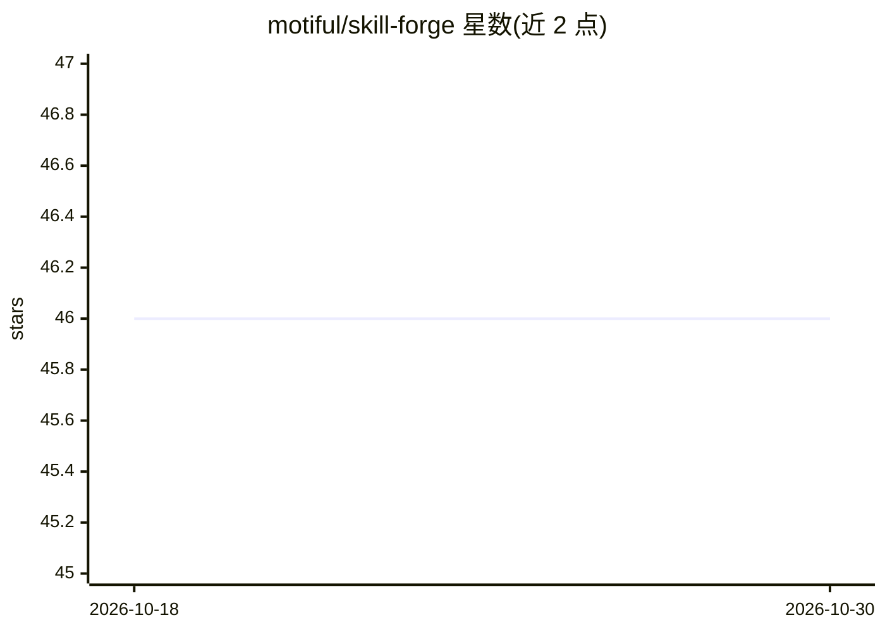

# motiful/skill-forge

⭐ 46 · Shell · MIT · 推送 2026-07-12 · [GitHub](https://github.com/motiful/skill-forge) · 个人维护

**AI agent 技能的验证、安全扫描与发布流水线工具**

面向 Agent Skills 作者的后创作工具：对已写好的技能做结构验证、触发短语与元数据检查、README 声明与实际能力一致性核对；扫描泄露的 API key、私钥与缺失的 .gitignore（关键问题阻止 push）；可审计整个项目目录发现全部技能/规则并逐一修复，或从混杂的原型文件夹中提取技能为独立仓库；发布时推送 GitHub 并向 Claude Code、Codex、Cursor、Windsurf、GitHub Copilot 的技能目录做符号链接。通过 npx skills add 安装，需 Git 与 Node.js，发布需 GitHub CLI。自身不编写技能内容。

## 筛选速览

| 维度 | 判定 | 备注 |
|---|---|---|
| AI 角色 | `ai-ecosystem` | LLM/agent 周边工具 |
| 许可风险 | `permissive` | MIT |
| 部署形态 | `library` | 以包/库形式分发 |
| 模型依赖 | — | README 未给出锁定关系 |
| 硬件要求 | — | 无带数字的原话,不猜 |
| 安装摩擦 | `low` | 无编译、无系统依赖或容器化 |
| 成熟度 | — | 结构信号不足 |

## 能力要点

- 审计整个项目目录，发现并逐个修复技能/规则/agent 指令
- 安全扫描：泄露密钥、凭据文件、缺失 .gitignore，关键问题阻止 push
- 一次发布到 GitHub 并符号链接到五个平台的技能目录
- 从混杂原型文件夹提取技能为干净仓库，不影响实验内容

## 适用场景

- 把本地原型技能整理成可发布、符合规范的独立仓库
- 发布前检查技能结构、描述覆盖与 README 声明是否夸大
- 扫描技能仓库中泄露的 API key 与凭据文件
- 将技能同时注册到 Claude Code/Cursor 等多个平台

## 场景标签

 · 领域:AI 开发者工具/Agent Skills

## 证据(README 行号)

> L30: - **Audits entire projects** — point forge at any directory and it finds every skill, rule, and agent instruction, 
> L33: - **Publishes to five platforms at once** — pushes to GitHub, then detects Claude Code, Codex, Cursor, Windsurf, an
> L96: npx skills add motiful/skill-forge -g

## 星数曲线

2026-10-18 46 → 2026-10-30 46（+0）

---
*卡片 v1 · prompt 1.4 · 生成 2026-10-25 · 置信度 high · 依据 README sha `888a85978bce` · [字段定义](../../DATASET.md)*
