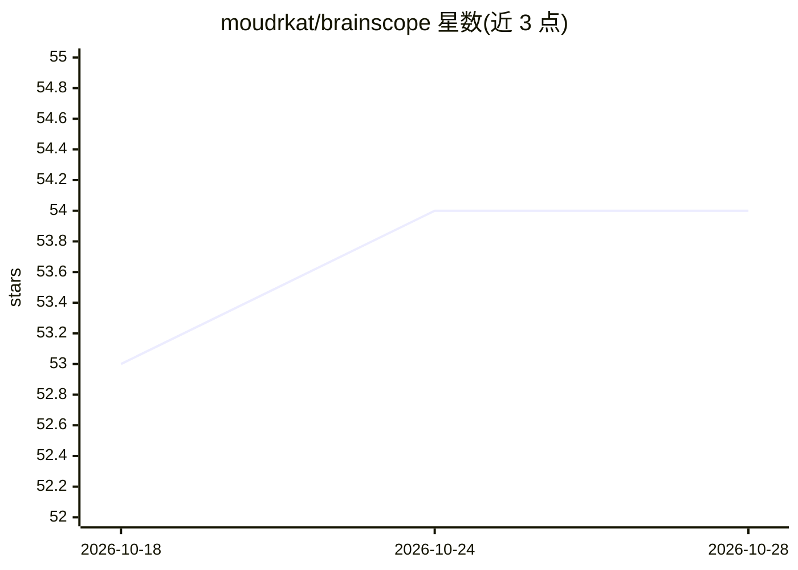

# moudrkat/brainscope

⭐ 54 · Python · MIT · 推送 2026-09-23 · [GitHub](https://github.com/moudrkat/brainscope) · 个人维护

**OpenAI 兼容推理服务器：实时观测与操控 HF 模型内部激活**

在任意 Hugging Face transformers 模型之上提供 OpenAI 兼容的 /v1 聊天服务（含 tool calls），同时把每 token、每层的 residual stream 活动流式送入浏览器可视化：logit lens、tuned lens、J-lens、注意力矩阵、神经元条带。支持从对比对提取方向做按请求 activation steering，兼容 hotwire-vllm 的 steering spec 并可导出向量；另含指令层级 steering（V-Steer）、激活探针、推理 trace 回放与人格审计。CPU 可跑 0.5B 模型，CUDA 上支持更大模型与 8bit 量化；服务本身无鉴权，README 提醒仅绑定可信网络。

## 筛选速览

| 维度 | 判定 | 备注 |
|---|---|---|
| AI 角色 | `ai-ecosystem` | LLM/agent 周边工具 |
| 许可风险 | `permissive` | MIT |
| 部署形态 | `self-host` | docker 或自建部署 |
| 模型依赖 | — | README 未给出锁定关系 |
| 硬件要求 | `cpu-ok` | |
| 安装摩擦 | `low` | 无编译、无系统依赖或容器化 |
| 成熟度 | — | 结构信号不足 |

## 能力要点

- logit/tuned/J-lens 三种逐层读出与注意力可视化
- per-request activation steering，兼容 hotwire-vllm spec 并可导出部署
- OpenAI 兼容 /v1 接口，应用只需改 base_url
- 激活探针低成本筛查 token，带 holdout AUC

## 适用场景

- 把现有 OpenAI 客户端应用指向本地模型并观察每层内部活动
- 提取并在线调节 steering 向量，导出到 vllm 部署
- 审计模型是否携带隐藏人格或后门行为
- 回放推理 trace，定位答案在 think 块中何时形成

## 场景标签

`推理引擎` · 领域:训练与推理

## 证据(README 行号)

> L13: An OpenAI-compatible chat server over any Hugging Face model with a live
> L53: - **Point your own app at it and watch real traffic** — no code changes:
> L97:   app["Your app (any OpenAI client)"] <-->|"base_url → /v1"| bs["brainscope server"]

## 星数曲线

2026-10-18 53 → 2026-10-28 54（+1）

---
*卡片 v1 · prompt 1.4 · 生成 2026-10-24 · 置信度 high · 依据 README sha `e18753e5df1b` · [字段定义](../../DATASET.md)*
