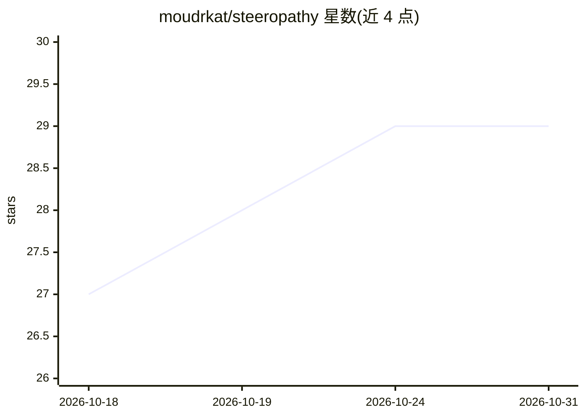

# moudrkat/steeropathy

⭐ 29 · Python · MIT · 推送 2026-10-01 · [GitHub](https://github.com/moudrkat/steeropathy) · 个人维护

**研究实验室：让 agent 通过激活向量而非文本互相通信**

构建在 brainscope 与 hidden-directions 之上的机制可解释性实验集合：同一模型的多份副本之间不传递文本，而是读取一方激活中的方向（steering vector）或 J-space 中未成 token 的词，将向量推入另一方的 forward pass。包含 worldof、zombie、handoff、unsaid 等约 20 个实验台，每个实验均带对照（placebo/ shuffled vector）。通过 pip 从源码安装，需另装 brainscope 承载模型（如 Qwen2.5-1.5B-Instruct），提供 Web UI。

## 筛选速览

| 维度 | 判定 | 备注 |
|---|---|---|
| AI 角色 | `ai-ecosystem` | LLM/agent 周边工具 |
| 许可风险 | `permissive` | MIT |
| 部署形态 | `library` | 以包/库形式分发 |
| 模型依赖 | — | README 未给出锁定关系 |
| 硬件要求 | — | 无带数字的原话,不猜 |
| 安装摩擦 | `low` | 无编译、无系统依赖或容器化 |
| 成熟度 | — | 结构信号不足 |

## 能力要点

- agent 间通道基于激活方向与 J-space，无文本传递
- 约 20 个实验台（worldof/zombie/handoff/unsaid 等），每个带 placebo 对照
- 三原语构建新实验：direction（对比均值相减）、push（POST /directions）、typed readout
- 提供 Claude Code 的 new-experiment 技能脚手架

## 适用场景

- 研究 steering vector 在 agent 通信中传递了什么
- 可视化方向与强度对模型输出的影响（滑块、绘图、音乐）
- 复现带对照的激活引导实验

## 场景标签

 · 领域:AI 研究可解释性

## 证据(README 行号)

> L81: No agent sees another's output. What crosses is read off the model:
> L85: brainscope hosts the model,
> L129: Two processes: brainscope hosts the model and does the internals work;

## 星数曲线

2026-10-18 27 → 2026-10-31 29（+2）

---
*卡片 v1 · prompt 1.4 · 生成 2026-10-26 · 置信度 high · 依据 README sha `76da217aa180` · [字段定义](../../DATASET.md)*
