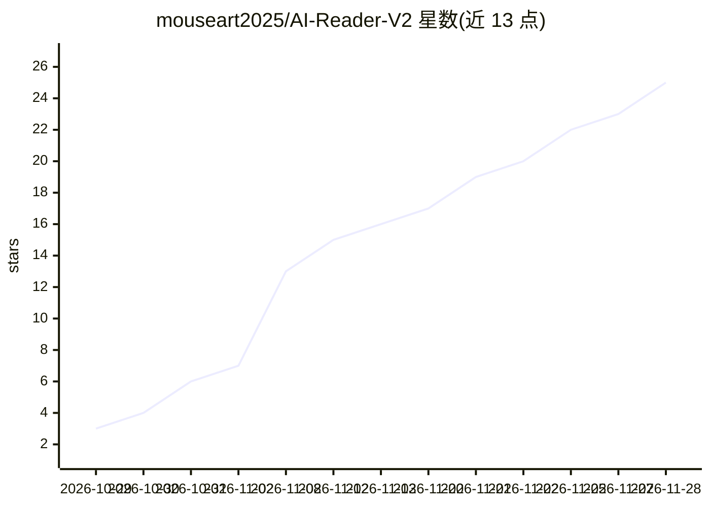

# mouseart2025/AI-Reader-V2

⭐ 25 · Python · AGPL-3.0 · 推送 2026-11-19 · [GitHub](https://github.com/mouseart2025/AI-Reader-V2) · [官网](https://ai-reader.cc) · 个人维护 · 中文 README

**上传小说自动生成人物图谱、地图、时间线与百科的桌面应用**

面向小说读者、创作者与文学研究者的本地优先分析工具：将整本书拆解为结构化的 ChapterFact（人物、关系、地点层级、物品、组织、事件），生成力导向关系图谱、多层级世界地图（Leaflet+GeoNames 或分层图）、多泳道时间线与实体百科，并提供可溯源的 RAG 问答与设定集导出（Markdown/Word/Excel/PDF）。数据存本机 SQLite+ChromaDB，可接本地 Ollama 或 10 家云端 OpenAI 兼容供应商。以 Tauri 桌面应用（内置 Python sidecar）分发，macOS/Windows 提供安装包；项目自述仍在快速迭代，分析结果建议结合原文核对。

## 筛选速览

| 维度 | 判定 | 备注 |
|---|---|---|
| AI 角色 | `ai-native` | 本体是模型或模型工具 |
| 许可风险 | `dual` | AGPL-3.0 |
| 部署形态 | `library` | 以包/库形式分发 |
| 模型依赖 | local-ok | 支持本地模型 |
| 硬件要求 | — | 无带数字的原话,不猜 |
| 安装摩擦 | `low` | 无编译、无系统依赖或容器化 |
| 成熟度 | `idea` | |

## 能力要点

- 每章抽取人物/关系/地点/物品/组织/事件，跨章聚合成实体档案
- 关系图谱自动识别 70+ 种关系类型，实体别名自动合并
- RAG 问答流式输出且答案可溯源；人工修正（别名合并/拆分、改名/隐藏）可撤销
- Tauri 2 桌面客户端内置 Python sidecar，下载即用

## 适用场景

- 整理网文/长篇小说的人物关系与世界观
- 文学研究中做角色网络与叙事结构的可视化探索
- 创作时导出设定集并检查世界观一致性
- 读书时高亮批注、场景索引定位原文

## 场景标签

`知识图谱` `文档问答` · 领域:知识与检索

## 证据(README 行号)

> L13: **上传一本小说，自动生成人物关系图、世界地图、时间线、百科和可溯源问答。**
> L85: |💬 RAG 问答|基于原文的检索增强问答，流式输出，答案可溯源|

## 星数曲线

2026-10-29 3 → 2026-11-28 25（+22）

---
*卡片 v1 · prompt 1.4 · 生成 2026-11-18 · 置信度 mid · 依据 README sha `ec954f7f5fbf` · [字段定义](../../DATASET.md)*
