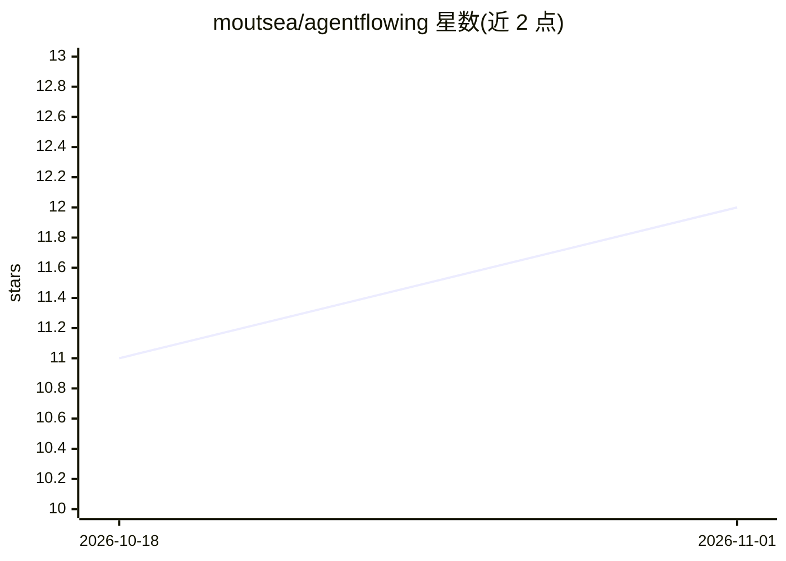

# moutsea/agentflowing

⭐ 12 · TypeScript · MIT · 推送 2026-10-25 · [GitHub](https://github.com/moutsea/agentflowing) · [官网](https://agentflowing.app) · 个人维护 · 中文 README

**Cloudflare 全栈 SaaS 脚手架：订阅与积分制 AI Agent 收费产品**

面向构建商业 AI Agent SaaS 的开源脚手架：单个 Cloudflare Worker 内集成 React 19 产品界面、Better Auth（OAuth/Magic Link）、组织多租户、基于 Agents SDK 与 Durable Objects 的流式会话、Workers AI 模型执行、D1 不可变积分账本（防透支、幂等扣退）、Stripe 订阅与微信/支付宝二维码支付、R2 文件上传、API key 访问与限流。定位 0.1.x 早期阶段，要求每次部署自行做安全审查、定价校准与 provider 配置。提供 git clone + pnpm 本地运行与 wrangler 生产部署流程。

## 筛选速览

| 维度 | 判定 | 备注 |
|---|---|---|
| AI 角色 | `ai-ecosystem` | LLM/agent 周边工具 |
| 许可风险 | `permissive` | MIT |
| 部署形态 | `library` | 以包/库形式分发 |
| 模型依赖 | — | README 未给出锁定关系 |
| 硬件要求 | — | 无带数字的原话,不猜 |
| 安装摩擦 | `low` | 无编译、无系统依赖或容器化 |
| 成熟度 | `idea` | |

## 能力要点

- Cloudflare Workers/D1/R2/Durable Objects 单 Worker 全栈架构
- D1 不可变积分账本：防透支、幂等扣费/退款、卡死任务自动退款
- Stripe 订阅 + 页内微信/支付宝二维码充值积分包
- Better Auth 组织租户、范围化哈希 API key、Cloudflare 限流与安全头

## 适用场景

- 快速启动一个按订阅或积分计费的 AI Agent SaaS 产品
- 需要多租户、计费与 API 访问的 Agent 商业化落地
- 避免自建应用服务器与 Kubernetes，直接部署到 Cloudflare

## 场景标签

`Agent 框架` · 领域:Agent 开发

## 证据(README 行号)

> L9: An open-source, Cloudflare-native starter for launching subscription and credit-based AI Agent SaaS products.
> L26: - Streaming conversations using Cloudflare Agents SDK and Durable Objects
> L27: - Workers AI model execution with server-controlled output and tool-step limits

## 星数曲线

2026-10-18 11 → 2026-11-01 12（+1）

---
*卡片 v1 · prompt 1.4 · 生成 2026-11-01 · 置信度 high · 依据 README sha `29706dee69f0` · [字段定义](../../DATASET.md)*
