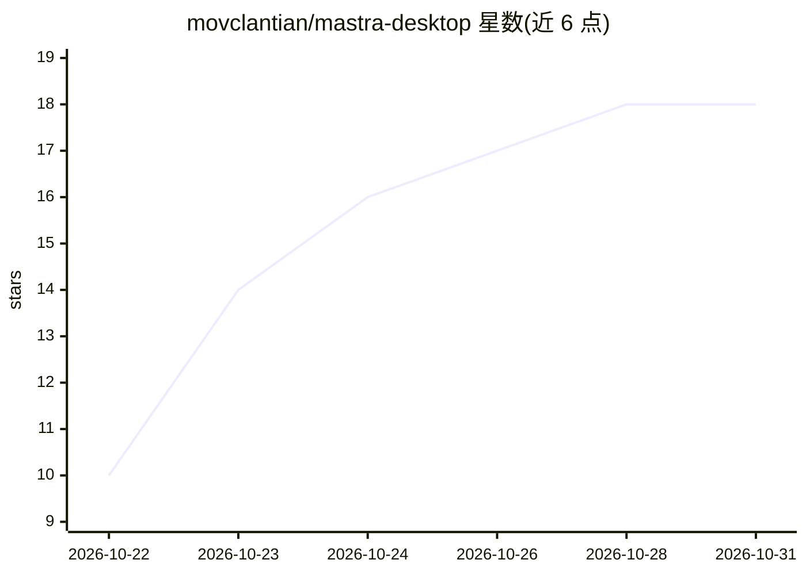

# movclantian/mastra-desktop

⭐ 18 · TypeScript · Apache-2.0 · 推送 2026-10-28 · [GitHub](https://github.com/movclantian/mastra-desktop) · [官网](https://mastrawork-notebook.sorryios-4070.chatgpt.site) · 个人维护 · 中文 README

**本地优先的多 Agent 桌面 AI 工作台，面向软件工程与知识工作**

基于 Mastra 框架与 Electron 的开源桌面应用，把一次 Agent 运行组织为落在具体工作区、可暂停、可回溯、可交接的任务。提供主 Agent 与专家团队委派（并行与嵌套）、计划/构建/复查三种受控执行模式、PTY 终端与原生浏览器视图、跨会话记忆与资料库，模型 Provider、MCP Server、技能等按需接入。「本地优先」指桌面宿主与本地数据边界留在本机，推理服务由用户自行配置，Mastra 服务默认监听本机 4111 端口。三平台提供安装包，也可从源码运行。

## 筛选速览

| 维度 | 判定 | 备注 |
|---|---|---|
| AI 角色 | `ai-native` | 本体是模型或模型工具 |
| 许可风险 | `permissive` | Apache-2.0 |
| 部署形态 | `desktop` | 安装包/桌面程序 |
| 模型依赖 | — | README 未给出锁定关系 |
| 硬件要求 | — | 无带数字的原话,不猜 |
| 安装摩擦 | `low` | 无编译、无系统依赖或容器化 |
| 成熟度 | `idea` | |

## 能力要点

- 主 Agent 通过 Mastra 原生 agent-* 工具委派专家成员，支持并行与嵌套
- 计划/构建/复查三种模式对读、编辑、执行分级授权，人工批准留在流程内
- Electron 桌面集成：原生浏览器视图、PTY 终端、凭据保险库
- 模型 Provider、MCP Server、技能、资料库、网页检索按需接入

## 适用场景

- 在一个桌面应用里完成读代码、改代码、跑命令、写文档的任务
- 拉专家团队分工执行并保留每一步记录
- 需要人工审批高风险操作的可控 Agent 工作流

## 场景标签

`多智能体` `编码 Agent` · 领域:Agent 开发

## 证据(README 行号)

> L17: MastraWork 是一个开源的桌面 AI 工作台，底层是 Mastra 框架和 Electron。它想解决的事情很具体。现在多数 AI 工具给你一段回答，事情就停在那儿。代码改到一半让它继续，它常常重新读一遍文件，从接不上的地
> L19: 这东西做给软件工程和知识工作用。Agent、团队、工作区、终端、浏览器、MCP、技能和资料库收在同一个应用里，围着同一个任务转。你在主窗口和一个主 Agent 对话，也可以拉一支专家团队，把读代码、查资料、跑命令、写文档这类活分出
> L33:  👥 Agent 团队

## 星数曲线

2026-10-22 10 → 2026-10-31 18（+8）

---
*卡片 v1 · prompt 1.4 · 生成 2026-10-29 · 置信度 mid · 依据 README sha `1faa42d64f7d` · [字段定义](../../DATASET.md)*
