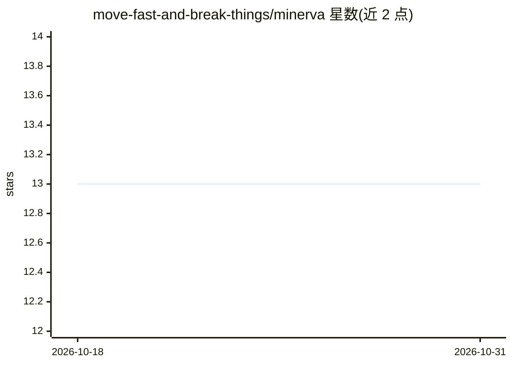

# move-fast-and-break-things/minerva

⭐ 13 · Python · MIT · 推送 2026-04-08 · [GitHub](https://github.com/move-fast-and-break-things/minerva) · 个人维护

**帮助社区成员学软件开发的 GPT Telegram 机器人**

面向 Move Fast and Break Things 社区的 Telegram 机器人：接入 OpenAI GPT 模型（默认 gpt-5.4，可用 OPENAI_MODEL 环境变量切换），在指定 Telegram 群组内回答软件开发学习问题。运行需要配置 Telegram bot token、OpenAI API key 与群组 id，通过 poetry 安装并运行，也提供 docker compose 启动方式。仅限单个指定群组内使用，按 OpenAI token 计费。

## 筛选速览

| 维度 | 判定 | 备注 |
|---|---|---|
| AI 角色 | `ai-native` | 本体是模型或模型工具 |
| 许可风险 | `permissive` | MIT |
| 部署形态 | `self-host` | docker 或自建部署 |
| 模型依赖 | — | README 未给出锁定关系 |
| 硬件要求 | — | 无带数字的原话,不猜 |
| 安装摩擦 | `low` | 无编译、无系统依赖或容器化 |
| 成熟度 | — | 结构信号不足 |

## 能力要点

- 接入 OpenAI GPT 模型，默认 gpt-5.4，可通过环境变量切换模型
- 通过 .env 配置 token 与群组 id，限制在单一 Telegram 群组运行
- 提供 poetry 与 docker compose 两种运行方式

## 适用场景

- 社区 Telegram 群里向成员解答软件开发学习问题
- 为学习社群部署一个 GPT 问答机器人

## 场景标签

`聊天机器人` · 领域:对话与助手

## 证据(README 行号)

> L5:  Minerva is a GPT-powered Telegram bot built to help Move Fast and Break Things community members learn software dev
> L11: By default, the bot uses the `gpt-5.4` model from OpenAI, which costs

## 星数曲线

2026-10-18 13 → 2026-10-31 13（+0）

---
*卡片 v1 · prompt 1.4 · 生成 2026-10-31 · 置信度 high · 依据 README sha `22cd7e33ea59` · [字段定义](../../DATASET.md)*
