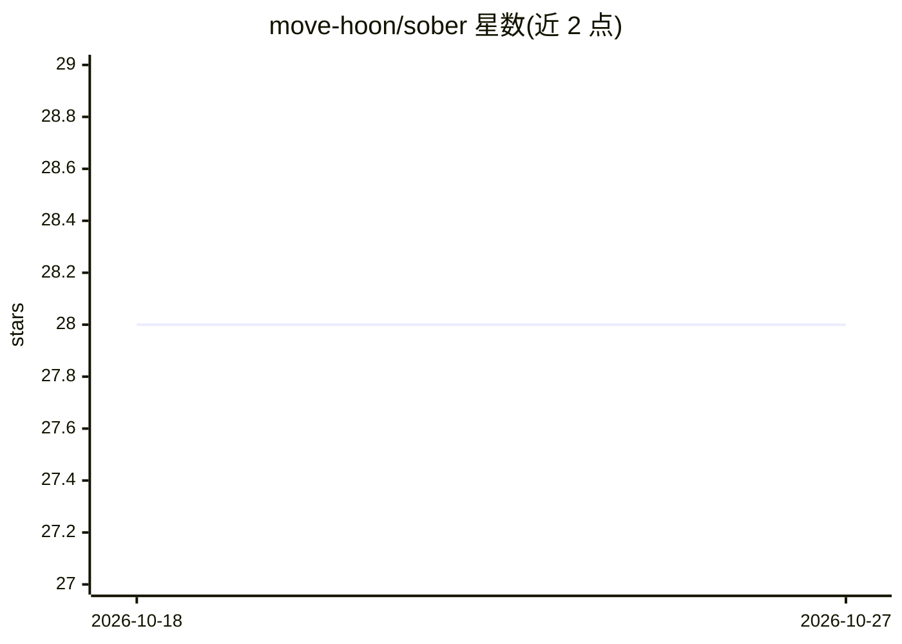

# move-hoon/sober

⭐ 28 · Shell · MIT · 推送 2026-06-18 · [GitHub](https://github.com/move-hoon/sober) · 个人维护 · 中文 README

**约束 Claude Code 与 Codex CLI 行为的本地控制层**

面向已在使用 Claude Code 或 Codex CLI 的开发者，Sober 以本地 harness 形式安装共享的 AGENTS.md 策略合同、技能包与钩子，把既有 agent 约束在『定位事实→只读必要内容→最小改动→验证→留下交接』的工作循环中。核心机制为 P0-P8 策略（上下文纪律、小补丁、完成前验证、失败即停、HANDOFF.md 会话记忆等），配合 ripgrep、ast-grep、Probe 等确定性工具。仅支持 macOS/Linux（Windows 需 WSL），需 Node.js 18+ 且 agent 已安装；卸载只移除 Sober 自有文件。

## 筛选速览

| 维度 | 判定 | 备注 |
|---|---|---|
| AI 角色 | `ai-ecosystem` | LLM/agent 周边工具 |
| 许可风险 | `permissive` | MIT |
| 部署形态 | `library` | 以包/库形式分发 |
| 模型依赖 | locked-api |  |
| 硬件要求 | — | 无带数字的原话,不猜 |
| 安装摩擦 | `low` | 无编译、无系统依赖或容器化 |
| 成熟度 | — | 结构信号不足 |

## 能力要点

- 以共享 AGENTS.md 合同（P0-P8 策略）同时约束 Claude Code 与 Codex CLI
- HANDOFF.md 本地会话记忆实现跨会话交接
- 配合 ripgrep/ast-grep/Probe/Serena 等确定性工具执行搜索与最小补丁
- sober doctor 诊断、sober uninstall 安全卸载，保留用户原有配置

## 适用场景

- 让 AI 编码 agent 少读全文件、只做最小安全改动
- 防止 agent 未验证就宣布完成，要求先跑测试或构建
- 跨会话保留任务上下文与交接记录

## 场景标签

`Agent 记忆` `提示工程` · 领域:Agent 开发

## 证据(README 行号)

> L17: Sober is a local control harness for Claude Code and Codex CLI. It keeps agents from over-reading, over-editing, an
> L127: Sober is a local control harness for the AI coding tools you already use: **Claude Code** and **Codex CLI**.
> L129: It installs a shared `AGENTS.md`, skills, and hooks that keep your existing agents inside a disciplined workflow:

## 星数曲线

2026-10-18 28 → 2026-10-27 28（+0）

---
*卡片 v1 · prompt 1.4 · 生成 2026-10-26 · 置信度 high · 依据 README sha `394173d97e44` · [字段定义](../../DATASET.md)*
