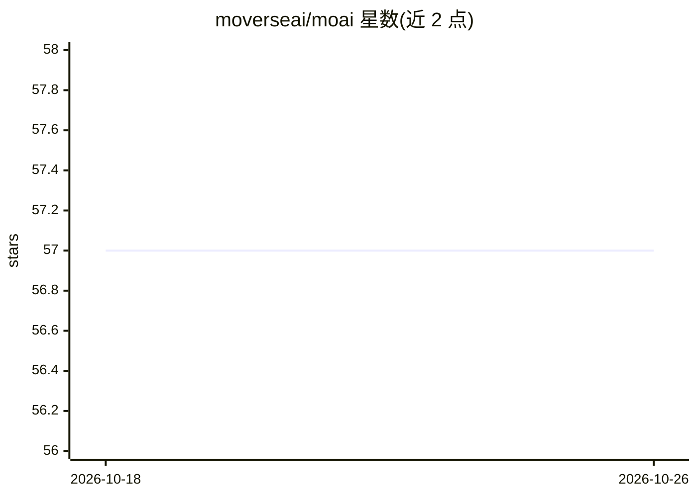

# moverseai/moai

⭐ 57 · Python · Apache-2.0 · 推送 2026-10-22 · [GitHub](https://github.com/moverseai/moai) · [官网](https://moai.readthedocs.io) · 组织维护

**PyTorch 模型开发套件：配置驱动训练/评测与可复现工作流**

基于 PyTorch 的 AI Model Development Kit（MDK），面向数据驱动模型的研发工作流。通过配置文件驱动六个 action：play（数据回放/统计）、train（训练）、evaluate（测试）、plot（跨模型性能可视化）、diff（配置差异报告）、reprod（复现实验）。设计上以 Hydra 驱动的建模语言（DML）管理超参数，Lightning 作为训练后端，支持插件式集成外部代码。README 自述处于 early development alpha 阶段。以 pip 包形式安装。

## 筛选速览

| 维度 | 判定 | 备注 |
|---|---|---|
| AI 角色 | `ai-ecosystem` | LLM/agent 周边工具 |
| 许可风险 | `permissive` | Apache-2.0 |
| 部署形态 | `library` | 以包/库形式分发 |
| 模型依赖 | — | README 未给出锁定关系 |
| 硬件要求 | — | 无带数字的原话,不猜 |
| 安装摩擦 | `low` | 无编译、无系统依赖或容器化 |
| 成熟度 | `idea` | |

## 能力要点

- 配置驱动的六个 action（play/train/evaluate/plot/diff/reprod）
- Hydra 驱动的数据驱动建模语言（DML）管理超参数
- 基于 monad 的模块化模型构建块与插件式外部代码集成
- 跨模型性能聚合分析与实验差异对比

## 适用场景

- 用配置文件组织模型训练与评测流程
- 对比不同超参数/配置版本的模型表现
- 按已解析配置复现历史实验

## 场景标签

`模型评测` `模型训练` `MLOps` · 领域:评测与运维

## 证据(README 行号)

> L13: **_moai_** is a PyTorch-based AI Model Development Kit (MDK) that aims to **improve data-driven model workflows, de
> L29: **_moai_** offers a set of data-driven workflow functionalities through specific integrated **actions**. These cons

## 星数曲线

2026-10-18 57 → 2026-10-26 57（+0）

---
*卡片 v1 · prompt 1.4 · 生成 2026-10-24 · 置信度 high · 依据 README sha `87a18ea48aca` · [字段定义](../../DATASET.md)*
